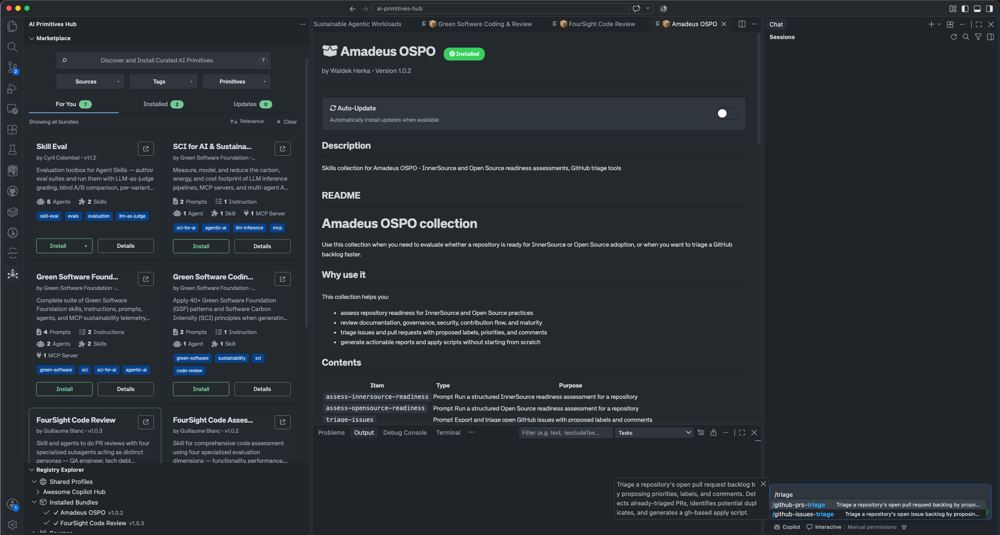
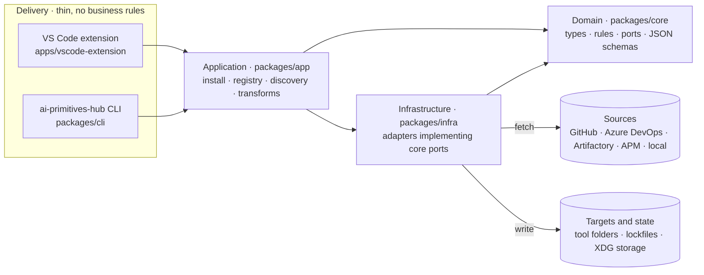

<div align="center">


# AI Primitives Hub

### The collaboration and governance platform for your AI primitives across teams and organizations.

Discover, govern, install, and share **prompts, instructions, agents, skills, MCP servers, plugins, and more** across every IDE, agent, and CLI — from a single source of truth.

[](https://marketplace.visualstudio.com/items?itemName=AmadeusITGroup.prompt-registry)
[](https://amadeusitgroup.github.io/ai-primitives-hub/)
[](https://github.com/AmadeusITGroup/ai-primitives-hub/releases)
[](https://opensource.org/licenses/Apache-2.0)
<br/>
[](https://marketplace.visualstudio.com/items?itemName=AmadeusITGroup.prompt-registry)
[](https://open-vsx.org/extension/AmadeusITGroup/prompt-registry)
[](https://www.npmjs.com/package/@ai-primitives-hub/cli)
[](https://www.npmjs.com/package/@ai-primitives-hub/cli)

#### Works with

[](#-works-with-your-tools)
[](#-works-with-your-tools)
[](#-works-with-your-tools)
[](#-works-with-your-tools)
[](#-works-with-your-tools)
[](#-works-with-your-tools)
<br/>
[](#-works-with-your-tools)
[](#-works-with-your-tools)
[](#-works-with-your-tools)
[](#-works-with-your-tools)
[](#-works-with-your-tools)

</div>

---

<p align="center">
  
</p>

> **ℹ️ Note:** This project was formerly known as **Prompt Registry**. The VS Code extension ID (`AmadeusITGroup.prompt-registry`) and lockfile names remain unchanged for compatibility — seeing `prompt-registry` in paths is expected.

## 💡 Why AI Primitives Hub?

- 🔍 **Marketplace experience** — browse, search, and one-click install curated bundles right inside VS Code.
- 🌐 **Write once, install everywhere** — the same bundle lands in the right folder and format for each IDE or agent CLI.
- 🛡️ **One governed organization hub** — authors publish from their own repositories, and a reviewed, central hub config approves, pins, and tracks what the whole organization installs.
- 🛡️ **Built for teams** — share role-based profiles, pin versions in a committed lockfile, and auto-update.
- 📦 **Bring your own source** — GitHub, Azure DevOps, Artifactory, APM, Awesome Copilot, or a local folder.
- ⚡ **Two front doors, one engine** — a VS Code extension and a scriptable CLI share the same core.

## 📑 Table of Contents

- [How It Works](#-how-it-works)
- [Works With Your Tools](#-works-with-your-tools)
- [Quick Start](#-quick-start)
- [Architecture](#%EF%B8%8F-architecture)
- [Documentation](#-documentation)
- [Contributing](#-contributing)
- [License](#-license)

## 🔄 How It Works

**Authors publish primitives, the organization hub governs them, consumers consume them.** Agents, skills, MCP server configs, plugins, and other primitives stay in the authors' own repositories. The organization hub is the governance layer in between. It decides which sources and versions are approved, reviews every change, and tracks what gets installed. Every client reads from that hub.

The animation at the top of this page walks through each stage.

| Role | What they do | How |
|------|--------------|-----|
| 🧑‍🔧 **Author** (collection or plugin owner) | Creates a repository with their primitives (**agents, skills, MCP server configs, plugins, prompts, instructions, hooks**), groups them into collections, and publishes them as versioned bundles. | `agent create`, `skill create`, `plugin create`, `collection create`, `bundle build`, GitHub releases |
| 🛡️ **Organization hub** (governance layer) | A central `hub-config.yml` that registers authors' repositories as approved **sources**, curates role-based **profiles** with pinned versions, and gates every change through review and validation. | `hub create`, `hub validate`, Visual Hub Configuration Editor |
| 🧑‍💻 **Consumer** | Imports the organization hub once, then browses, installs bundles, or activates profiles. Bundles are downloaded from the approved sources and placed in each tool's own folders and formats. | VS Code extension, `hub add`, `profile activate`, `install` |

### 🛡️ Governance Controls

| Control | What the organization gets |
|---------|----------------------------|
| **Approved sources** | The hub catalog lists only the sources registered in `hub-config.yml`. |
| **Reviewed changes** | Adding a source or changing a profile is a pull request on the hub repository, with normal code-review protections. |
| **Validation** | `hub validate` checks the schema, source and profile references, and bundle IDs, and can resolve every profile's bundles with `--check-sources`. Authors can validate collections in CI with the [validate-collections action](./github-actions/validate-collections/). |
| **Lockfile scanner** *(coming soon)* | Hub pull requests will scan lockfiles and primitives before a source is approved. |
| **Version pinning** | Profiles pin each bundle to a SemVer version (or `latest`). Repository installs record versions and file checksums in `prompt-registry.lock.json`. |
| **Usage tracking** | With `telemetry` configured in the hub, the VS Code extension reports bundle install, update, and uninstall events, plus profile and source events, to your Elastic Search, respecting each user's VS Code telemetry setting. |
| **Controlled distribution** | `hub replicate` mirrors SHA-256-verified releases into Artifactory. See [Hub Replication](./docs/reference/hub-replication.md). |

See [Creating a Hub](./docs/author-guide/creating-a-hub.md) and [Profiles and Hubs](./docs/user-guide/profiles-and-hubs.md).

## 🧩 Works With Your Tools

- **Tools** — IDEs: VS Code, VS Code Insiders, Kiro, Windsurf, Cursor, and Devin. CLI agents: GitHub Copilot CLI, Claude Code, Kiro CLI, OpenCode, and Devin CLI. The VS Code extension runs in VS Code, VS Code Insiders, Kiro, and Windsurf; the CLI installs into all of them (`ai-primitives-hub target types`).
- **Primitives** — prompts, instructions, chat modes, agents, skills, MCP servers, hooks, and plugins work everywhere. Tool-specific kinds (Kiro steering and specs, Claude Code commands and output styles, Cursor rules, OpenCode tools, Devin knowledge and playbooks, Kiro and Devin powers) install only where the tool supports them; mixed bundles are all-or-nothing unless you add `--skip-unsupported`.
- **Sources** — GitHub releases, Awesome Copilot collections, skills repositories, APM packages, Azure DevOps, and JFrog Artifactory, plus local folders for bundles, collections, skills, and APM packages. See [Sources](./docs/user-guide/sources.md).

## 🚀 Quick Start

**🖥️ In VS Code (and Kiro, Windsurf):**
Search **"AI Primitives Hub"** in the Extensions panel and install it. On first launch, pick your organization's hub. Its sources sync and its first profile activates. Then browse the marketplace view and click **Install** on any bundle. To build from source, see [`apps/vscode-extension/README.md`](./apps/vscode-extension/README.md).



**⌨️ From the terminal:**

```bash
npm install -g @ai-primitives-hub/cli
ai-primitives-hub hub add --location <owner/hub-repo>     # import the hub and make it active
ai-primitives-hub target add my-claude --type claude-code
ai-primitives-hub profile activate <profile-id> --target my-claude
# or install a single bundle from one of the hub's sources
ai-primitives-hub install <bundle-id> --source <source-id> --target my-claude
```

See the [Command Reference](./docs/reference/commands.md) for all CLI commands.

**🧑‍🔧 As a collection or plugin owner:**
Structure your primitives and publish them from your own repository. See the [Author Guide](./docs/author-guide/creating-source-bundle.md) and [Publishing](./docs/author-guide/publishing.md).

**🛡️ Setting up an organization hub:**
Register authors' repositories as approved sources, curate profiles, and configure governance in `hub-config.yml`. See [Creating a Hub](./docs/author-guide/creating-a-hub.md) and [Adding Profiles and Sources](./docs/author-guide/adding-profile-source-to-hub.md).

**🛠️ As a contributor:**

Requires Node.js 24 or newer and pnpm 11 or newer. See
[CONTRIBUTING.md](./CONTRIBUTING.md) for the complete development setup.

```bash
git clone https://github.com/AmadeusITGroup/ai-primitives-hub.git
cd ai-primitives-hub
pnpm install
pnpm build        # build all workspace packages
pnpm test         # run all workspace tests
pnpm lint
```

## 🏗️ Architecture

AI Primitives Hub follows ports and adapters (Clean Architecture): one shared domain behind two thin front doors, with dependencies pointing inward only.



- **Composition root:** the CLI and the extension wire `infra` adapters into `app` at startup and hold no business rules. The extension is moving its remaining services onto `app` ([ADR-0001](./docs/contributor-guide/architecture/adr/0001-ports-and-adapters-for-cli-and-extension.md)).
- **Other folders:** `lib/` (legacy collection scripts), `github-actions/validate-collections/` (CI validation action), `docs/` and `website/` (documentation and Docusaurus site).

Learn more: [Clean architecture](./docs/contributor-guide/architecture/library-centric-architecture/clean-architecture.md) · [C4 diagrams](./docs/contributor-guide/architecture/library-centric-architecture/system-context.md) · [Codemap](./docs/contributor-guide/architecture/library-centric-architecture/codemap.md) · [ADRs](./docs/contributor-guide/architecture/adr/adr-index.md) · [Contributor architecture guide](./docs/contributor-guide/architecture.md)

## 📚 Documentation

- [User Guide](./docs/user-guide/getting-started.md)
- [Author Guide](./docs/author-guide/creating-source-bundle.md)
- [Contributor Guide](./docs/contributor-guide/development-setup.md)
- [Architecture](./docs/contributor-guide/architecture.md)
- [Reference](./docs/reference/commands.md)

See the full index: [`docs/README.md`](./docs/README.md).

## 🤝 Contributing

See [CONTRIBUTING.md](./CONTRIBUTING.md) and [CODE_OF_CONDUCT.md](./CODE_OF_CONDUCT.md). For security, see [SECURITY.md](./SECURITY.md).

## 📄 License

[Apache 2.0](./apps/vscode-extension/LICENSE.txt)
