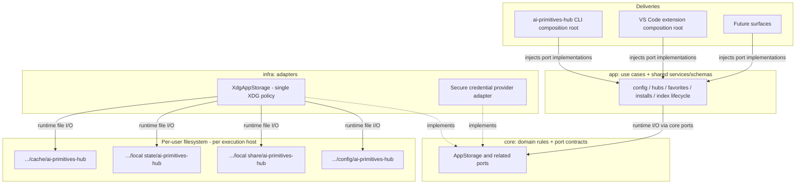

# ADR-0011: Shared XDG Application Storage Across Delivery Surfaces

| Field | Value |
|---|---|
| Status | Accepted |
| Priority | Medium |
| Component | Application Architecture / Storage |
| Decision Date | 2026-11-07 |
| ADR ID | 0011 |
| Amends | ADR-0005 (decisions 2 and 3), ADR-0006 (decisions 1, 3 and 4) |
| Leaves in force | ADR-0001, ADR-0004, ADR-0007 |

## Implementation Status (2026-11-08)

Decision confirmed and implemented: **XDG is the only storage location**. The
extension no longer has a storage mode switch; `RegistryStorage`, hub storage,
bundle content, tool binaries, contribution sessions and shared state resolve
under the XDG data, config and state directories. Legacy IDE global storage is
detected at activation, migration is insisted on (Migrate Now / Later,
re-prompted every activation), and the legacy root is only ever read and never
modified. Migration copies and transforms into the shared layout, merging by id
where well defined and reporting conflicts, and records a journal entry in
`$XDG_STATE_HOME/ai-primitives-hub/migrations.json`; several IDEs each migrate
their own legacy root into the same shared state.

## Detailed Outcome

Option 3 selected: all application-owned configuration, durable data, caches,
and lifecycle state converge on one shared, infra-owned XDG storage policy and
shared `app`-layer services and schemas across the CLI, the VS Code
extension, and future delivery surfaces. Options 1 and 2 are not selected.

This decision accepts the **direction** only. It does not mark any
implementation, migration, or production-default change as complete; those
remain gated on the evidence requirements below.

## Context

The hub is delivered through two surfaces - the `ai-primitives-hub` CLI and
the VS Code extension - over one shared domain (`core`/`infra`/`app`).
The preceding ADRs established a split that this decision amends:

- ADR-0005 defines the `core.AppStorage` port and an XDG-based `infra`
  implementation (`packages/infra/src/storage/xdg-app-storage.ts`), but
  decision 3 makes the extension's `globalStorageUri` backing a deliberate,
  permanent exception.
- ADR-0006 shares semantic caches under an XDG-compatible policy but keeps
  client-owned state in client stores and permits divergent native-platform
  cache fallback.

That split prevents complete persistence parity across surfaces. Concretely:

- **Same root is not the same protocol.** The CLI persists `config.yml`,
  `hubs/<id>.yml`, and `active-hub.json`; the extension's `RegistryStorage`
  owns a registry `config.json`, while the separate `HubStorage` owns
  root-level hub files and `activeHubId.json`. Two surfaces can share a
  directory and still not understand each other's configuration.
- **Configuration and durable records still diverge.** Some semantic caches
  already reuse shared XDG composition, but that partial cache reuse does
  not complete convergence: configuration, durable records, and freshness
  behavior still differ between surfaces.
- **Multi-process safety is incomplete today.** `XdgAppStorage.setState`
  performs an unlocked read/modify/write, and `RegistryStorage` relies on an
  instance-local mutation queue plus an indefinitely cached config.
  Sharing paths without a concurrency design exposes lost updates and stale
  reads that atomic rename alone cannot fix.
- **Some apparently cached content is durable.** User installs can symlink
  into bundle backing directories, and uninstall reads manifests there;
  treating that content as evictable cache can break installs.
- **Credential semantics diverge.** A `credentialRef` means a VS Code secret
  label in the extension but an environment-variable name in the CLI;
  sharing configuration must not silently export tokens or assume these
  references resolve identically.

The structural seams for convergence already exist: `core.AppStorage`,
`infra.XdgAppStorage`, shared hub/favorites/activation stores, shared `app`
use cases, and an XDG-backed primitive-index composition in both deliveries.
The remaining work is ownership, schema convergence, migration, and
multi-process safety - not introducing another filesystem abstraction.

## References

- [ADR-0001: Ports & Adapters Across the CLI and the VS Code Extension](./0001-ports-and-adapters-for-cli-and-extension.md)
- [ADR-0004: CLI-Only Rebrand - Keep Lockfile and Extension Identity Stable](./0004-cli-only-rebrand-keep-lockfile-and-extension-identity-stable.md)
- [ADR-0005: Universal, XDG-Based Application Storage Port](./0005-universal-xdg-based-app-storage.md)
- [ADR-0006: Shared Semantic Cache and Client-Owned State](./0006-shared-semantic-cache-and-client-owned-state.md)
- [ADR-0007: Source-Aware GitHub App Authentication](./0007-source-aware-github-app-authentication.md)
- [XDG Base Directory Specification](https://specifications.freedesktop.org/basedir-spec/latest/)

## Goal

> All application-owned configuration, durable data, caches, and lifecycle
> state converge on one shared, infra-owned XDG storage policy and shared
> `app`-layer services and schemas, so every delivery surface reads and
> writes the same canonical per-user store.

## Options

### Option 1 - Keep separate per-surface stores (status quo)

CLI under XDG roots, extension under `globalStorageUri`, shared mechanisms
only where already built. **Not selected.**

- Pros: no relocation required by this option; no amendment of accepted
  ADRs; retains existing host-managed locations and isolation where the
  platform provides them.
- Cons: permanent duplicated configuration and caches; surfaces cannot see
  each other's state; every future client must reconcile the existing split;
  divergence grows with each feature.

### Option 2 - Share caches only (ADR-0006 as-is)

Keep client-owned state and configuration per surface; share only
reconstructible semantic artifacts. **Not selected.**

- Pros: smallest change; already accepted policy; avoids cross-client
  durable-state migration under this option (it does not resolve the
  existing open ownership questions).
- Cons: leaves the largest duplication (configuration, install records,
  state) in place; does not reach headless parity; the coupling findings in
  Context (dual config schemas, divergent `credentialRef` meaning) persist.

### Option 3 - Full convergence on shared XDG storage (SELECTED)

One shared XDG policy and shared versioned schemas/services for all
application persistence; delivery surfaces keep only UI and host-integration
concerns.

- Pros: single authoritative store; true headless/CLI parity; one migration
  and compatibility story; future surfaces inherit the policy.
- Cons: must solve ownership, multi-process safety, schema convergence,
  secure credentials, and migration conflicts first; amends two accepted
  ADRs; largest reviewed surface area.

## Options Comparison

| Criterion | Option 1 - separate stores | Option 2 - shared caches only | Option 3 - full convergence |
|---|---|---|---|
| Migration | None required by this option | Cache-only, additive | Full staged migration with compatibility window |
| Configuration/state convergence | None; divergent schemas persist | None; per-surface config/state stays | Shared versioned schema, loader, precedence |
| Cache reuse | Partial ad-hoc reuse today, with remaining duplication | Shared namespaced semantic caches | Shared caches plus shared durable/state namespaces |
| Portability | VS Code required for extension-owned data | Partial; headless can reuse caches | Headless parity; no host needed for canonical persistence |
| Operational complexity | Lowest now; rising divergence cost | Low; one extra shared mechanism | Highest up front; single policy afterwards |

## Decision

1. **One shared XDG policy, owned by `infra`.** Canonical application
   configuration, durable data, caches, and state resolve through one
   `infra`-owned XDG base-directory policy and shared `app`-layer
   services/schemas. Composition roots in the CLI and the extension inject
   implementations of `core` ports; no `vscode` types in `app`/`core`, and
   the extension never imports CLI internals. Shared services and
   orchestration live in `app`; domain and storage contracts/rules stay in
   `core`. Extend and reconcile the existing `AppStorage` path
   capabilities/resolvers - do not add a third resolver or a new generic
   state database.
2. **Canonical roots.** The `XDG_*` variables are **base** roots; the
   application namespace `ai-primitives-hub` is appended to them - they are
   not aliases for the fallback locations:

   | Content classification | Absolute (XDG set) | Fallback (XDG unset) |
   |---|---|---|
   | Configuration | `$XDG_CONFIG_HOME/ai-primitives-hub` | `<home>/.config/ai-primitives-hub` |
   | Durable data | `$XDG_DATA_HOME/ai-primitives-hub` | `<home>/.local/share/ai-primitives-hub` |
   | Cache | `$XDG_CACHE_HOME/ai-primitives-hub` | `<home>/.cache/ai-primitives-hub` |
   | State | `$XDG_STATE_HOME/ai-primitives-hub` | `<home>/.local/state/ai-primitives-hub` |

   Empty or relative XDG values are treated as unset (and may warn),
   consistently, by the single shared resolver - they never resolve to an
   unintended working-directory root. The fallback examples above are
   home-relative notation: on all supported OSes (Linux, macOS, Windows) the
   shared resolver joins them with platform path APIs using one injected
   home resolver, rather than hard-coding POSIX absolute paths on Windows.
   Existing explicit overrides are compatibility inputs handled centrally
   and documented, not another delivery-specific resolver. `XDG_RUNTIME_DIR`
   is optional and only for ephemeral coordination (e.g., lock files), never
   durable data. These are required semantics: where current code does not
   yet handle `state` or match every rule above, this decision establishes
   the requirement.
3. **Shared mechanism, not globally shared values.** Stores are scoped by
   canonical workspace, target, client, and execution-host identities as
   appropriate. Active-hub and favorites may be shared defaults; profile
   activation and install ownership require explicit scope. The store is
   per-user, per-execution-host filesystem: no automatic synchronization
   across WSL/SSH/containers/devices and no distributed-filesystem safety
   claim.
4. **Configuration convergence.** One shared versioned schema, loader,
   validation, and documented precedence; the extension's settings UI
   becomes an adapter over that configuration, never a hidden second
   authoritative settings store. The exact field mapping and precedence
   contract is a follow-up reviewed artifact; this ADR does not assert
   current CLI and extension schemas are interchangeable.
5. **Install records and durable payloads.** A long-term common
   install-record/ownership model across surfaces is required, but the exact
   record protocol is a follow-up aligned with issues
   [#568](https://github.com/AmadeusITGroup/ai-primitives-hub/issues/568) and
   [#572](https://github.com/AmadeusITGroup/ai-primitives-hub/issues/572) and
   reconciled with
   [#644](https://github.com/AmadeusITGroup/ai-primitives-hub/issues/644)
   **before** any production sharing - no third record design here.
   Installed symlink backing content and manifests are durable data and are
   **never** evictable cache while referenced. Repository lockfiles, project
   policy files, and host-required primitive/MCP output locations are not
   moved or renamed.
6. **Credentials stay outside XDG data/cache.** No plaintext secrets in XDG
   files. Use common secure-provider contracts; authenticated headless
   operation must not require VS Code persistence, and a VS Code session may
   be an optional credential source but never the canonical sole store. The
   secure persistent backend and the cross-surface meaning of
   `credentialRef` require an explicit security design; this ADR selects no
   keychain implementation and authorizes no secret relocation. ADR-0007
   remains in force, including its authorized bootstrap-input handling:
   GitHub App **installation tokens stay process-local and are never
   persisted**, and no token or PEM may be copied into shared
   config/data/cache/state, migration snapshots, diagnostics, or logs.
   Legitimate secure credential backends and existing private-key input
   files handled per ADR-0007 are unaffected.
7. **Multi-process safety.** Mutable namespaces require a bounded
   transaction-level inter-process lock or single-writer policy,
   reload-before-mutate plus external-change visibility, atomic publication
   and recovery for multi-file state, version-compatibility and
   malformed-data fail-safe behavior, and per-user/trust-boundary isolation.
   Atomic rename alone is not serialization. Cache identity includes the
   relevant source/profile inputs, and cache purge must never touch durable
   referenced payloads, configuration, state, or install records.

## Amendments to Accepted ADRs

| Accepted decision | Effective amendment |
|---|---|
| ADR-0005, decision 3 (permanent `globalStorageUri` exception) | Replaced by a **migration-only compatibility backend**: existing data stays readable during a bounded window, but permanent canonical persistence converges on XDG. |
| ADR-0005, decision 2 (XDG path taxonomy) | Extended with a `state` root (`XDG_STATE_HOME`) alongside config/data/cache. |
| ADR-0006, decision 1 | Amended only insofar as it preserves old physical placement; its non-destructive compatibility guarantees are retained. |
| ADR-0006, decision 4 (client-owned state in client stores) | Replaced: client/workspace **ownership** semantics stay, but physical persistence moves into namespaced XDG stores. |
| ADR-0006, decision 3 (native-platform cache fallback allowance) | Replaced by the single XDG policy (home-relative on all supported platforms). |
| ADR-0006, decisions 5-8 (compatibility-keyed indexes, invalidation/last-known-good, concurrency, shared search contracts, and the typed read-only search contract) | Preserved unchanged. |
| ADR-0001 (dependencies/strangler-fig), ADR-0004 (names/lockfiles), ADR-0007 (auth boundaries) | Remain in force; nothing here overrides them. |
| All accepted ADR records | Remain immutable; this ADR amends by superseding clauses, never by editing accepted text. |

## Target Layout

## Consequences and Risks

- Positive: one authoritative store, headless parity, single migration and
  compatibility story, no third store for future surfaces.
- Negative: requires amending two accepted ADRs and shipping the safety
  design (locking, versioning, migration, secure credentials) before any
  production default flips.
- Risks: split-brain during concurrent legacy/XDG writes; silent data loss if
  install backing content is treated as cache; secret leakage if credential
  convergence is shortcut; cross-host assumptions (WSL/SSH/containers) that a
  per-user filesystem store cannot satisfy.

## First Validation Slice

The first implementation evidence is a bounded, synthetic validation slice -
it proves only its own scope, not whole-extension independence or concurrent
production safety:

- **Scope:** bidirectional CLI/extension sharing of hub definitions,
  active-hub selection, and favorites, plus a compatible primitive-index
  cache using BM25/local fixtures only.
- **Isolation:** absolute `HOME`/XDG roots under a synthetic workspace and a
  fake IDE sentinel instead of a real VS Code host; no real installs,
  credentials, user data, or model/source downloads.
- **Freshness:** a running surface observes the other surface's mutations
  through external-change reload, not process restart.
- **Defaults:** legacy per-surface storage remains the production default
  outside the explicit opt-in mode; nothing is migrated or deleted.

## Rollout and Production Gates

1. Bounded synthetic validation slice as defined above - no scope expansion
   into installs or credentials.
2. Shared config/protocol/freshness/concurrency contract, plus the secure
   credential design.
3. Install-ownership/backing-data gate (reconciled with #568/#572/#644).
4. Authorized preview: validate-copy, journal, conflict resolution, and an
   explicit authority switch. Originals preserved; migration readers are
   non-authoritative and time-bounded inside an announced compatibility
   window. No indefinite dual-write; old clients still writing legacy stores
   get an explicit compatibility/blocking policy.
5. Coordinated production default only after all gates pass. Parallel lanes
   are possible, but the validation slice alone does not prove full
   independence. Legacy-file cleanup is a separate, reviewed, user-visible
   operation - never automatic or destructive under this ADR. Rollback must
   account for post-cutover writes, not blindly flip back to stale legacy
   state.

**Production gates (required future evidence, not completed results):**

- Cross-surface bidirectional config/cache I/O; a running extension observes
  CLI mutations.
- Concurrency tests show no lost updates under parallel writers.
- Interruption, corrupt files, and newer-schema reads preserve data.
- Cache eviction leaves installs fully functioning.
- No hidden VS Code storage is used for canonical application persistence in
  converged mode.
- Headless secure authentication without VS Code persistence.
- Migration conflict/retry/rollback paths demonstrated.
- Supported OS and remote execution-host matrix validated.

## Follow-Up Action Checklist

- [ ] Config schema/precedence contract (field mapping, documented
      precedence, UI adapter plan)
- [ ] Secure credential backend design + cross-surface `credentialRef`
      semantics
- [ ] Install-record ownership protocol aligned with #568/#572, reconciled
      with #644
- [ ] Multi-process locking/journaling design for mutable namespaces
- [ ] Migration preview/conflict-resolution UX and compatibility-window
      policy (incl. old-client blocking stance)
- [ ] Bounded synthetic validation slice execution
