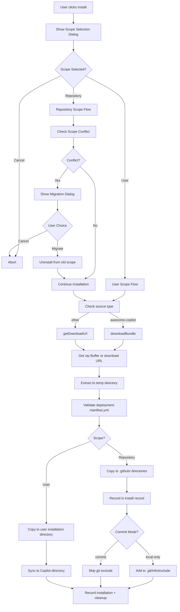
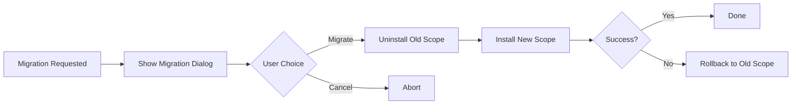
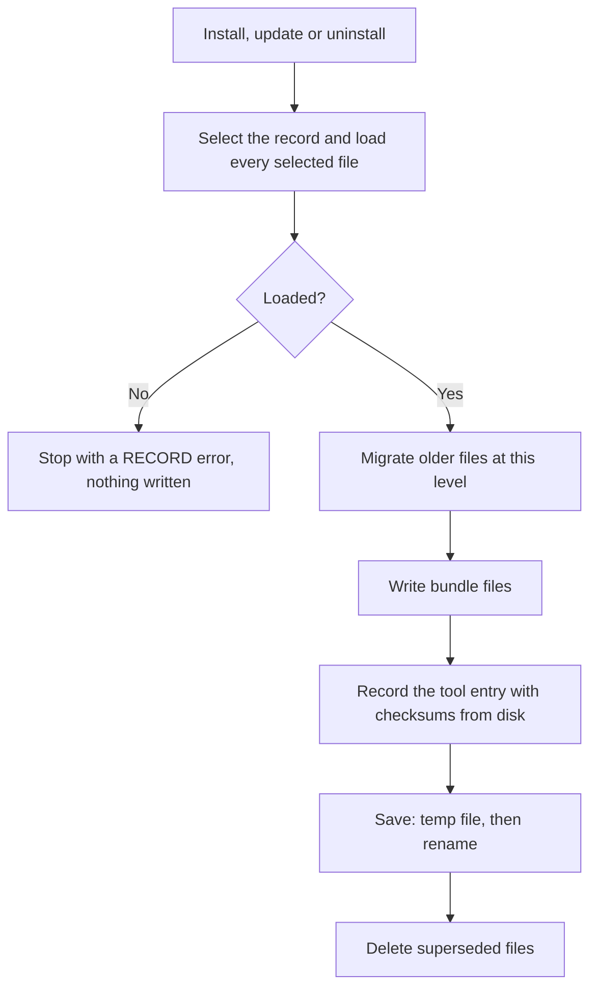
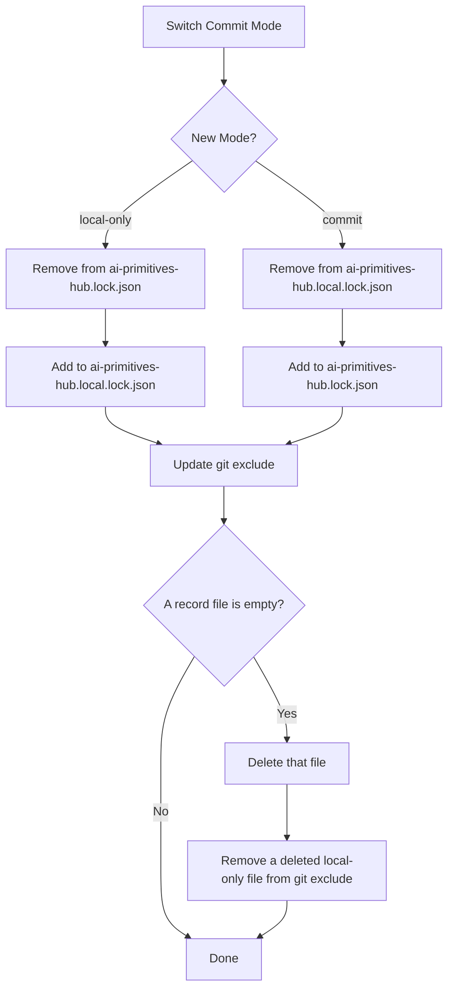
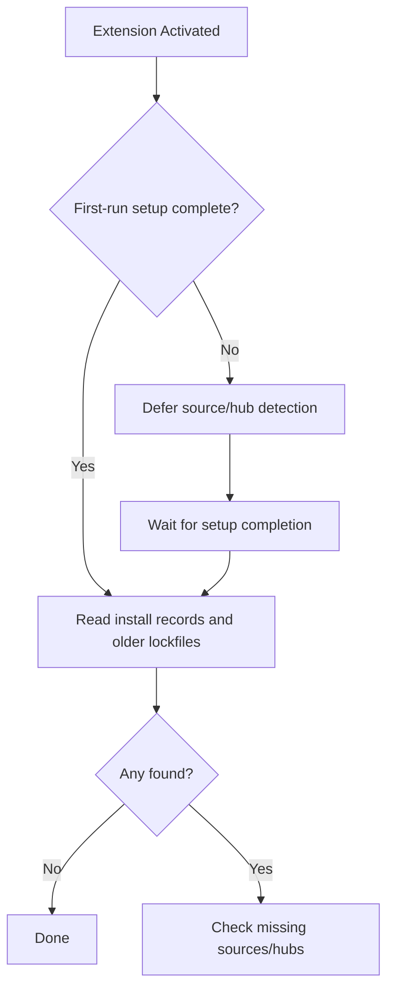
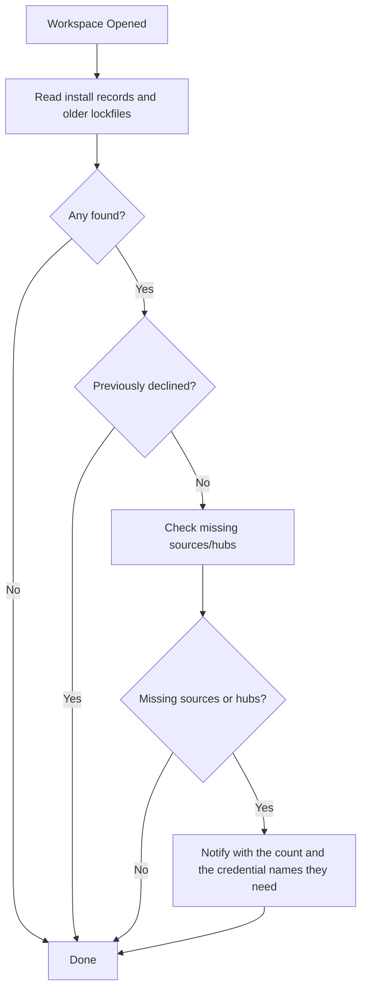

# Installation Flow

## Directory Structure

### User Scope

```
Extension Storage/
├── bundles/                          # Installed bundles
│   └── testing-automation/
│       ├── deployment-manifest.yml
│       └── prompts/
│           └── testing-prompt.prompt.md
└── registry.json                     # Sources and records

Copilot Directory (macOS)/
~/Library/Application Support/Code/User/prompts/
└── testing-automation/
    └── testing-prompt.prompt.md
```

### Repository Scope

```
your-repo/
├── .github/
│   ├── prompts/
│   │   └── my-prompt.prompt.md
│   ├── agents/
│   │   └── my-agent.agent.md
│   ├── instructions/
│   │   └── my-instructions.instructions.md
│   └── skills/
│       └── my-skill/
│           └── skill.md
├── .vscode/
│   └── mcp.json                      # MCP server configurations
├── ai-primitives-hub.lock.json         # Install record for committed bundles
└── ai-primitives-hub.local.lock.json   # Install record for local-only bundles (git-excluded)
```

User-scope installs are recorded in `ai-primitives-hub.user.lock.json` in the user config folder (see [Install Records](#install-records)).

## Installation Steps



## Planned Security Gate for Custom Sources

The scanner is currently an explicit CLI and extension workflow, not an
automatic installation gate. A future policy-controlled gate must scan
extracted bytes after manifest/integrity validation and before writing target
files, MCP configuration, lockfiles, or installation records. It must reuse the
shared scanner contract and explicitly distinguish report-only, warning, and
blocking policies. See [Security Scanner Architecture](./security-scanner.md).

## Binary Safety and Integrity Verification

Bundle files are copied to the target byte-for-byte and verified after every write:

- **Binary-safe writes** — writers use the `FileSystem` port's `readFileBytes`/`writeFileBytes` for all payloads. Text payloads (strict UTF-8) may additionally pass through a target-specific `ResourceTransformer`; binary payloads (images, archives, office documents) are never decoded as text — a lossy UTF-8 round-trip replaces invalid sequences with U+FFFD and corrupts them.
- **Post-write verification** — after each write, the installed file is re-read and compared against the bytes the writer intended to write (`verifyWrittenBytes` in `core`'s `domain/install/integrity`). A mismatch throws `FileIntegrityError` (`BUNDLE.INTEGRITY_MISMATCH`) instead of leaving a silently corrupted artifact.
- **Executable bits** (issue #577) — extractors tag each file's bytes with the permission bits its source recorded, using `withFileMode` (`ExtractedFile.mode`, `rwxrwxrwx` only): `ZipBundleExtractor` from the zip entry's Unix mode, `readLocalBundle` from `FileSystem.stat`. Map copies keep the mode; a byte copy drops it, which means "default mode". Both writers (`FileTreeTargetWriter`, `RepositoryScopeWriter`) call `applyFileMode` (`core`'s `domain/install/file-mode`) after each verified write; it calls the optional `FileSystem.setExecutable`. `NodeFileSystem.setExecutable` adds execute where read is granted (or clears every execute bit for a non-executable entry), never adds write or special bits, and does nothing on Windows. It is best effort: a `chmod` rejected with `EPERM`, `ENOTSUP`, `EOPNOTSUPP` or `EINVAL` (vfat/exFAT mounts, files owned by another user) leaves the mode unchanged instead of failing the install; other errors still propagate. Archives that resolvers synthesize with `buildZip` (`skills`, `awesome-copilot`) record `0644` for every entry. Filesystems without `setExecutable` (in-memory test doubles, the VS Code extension's writer filesystem) keep today's behaviour. Install records store no mode.
- **Upstream layers already verified** — zip entry CRC-32 is checked during extraction, and governed (`formatVersion: 1`) deployment manifests carry per-file `size` + `sha256` validated against the extracted bytes.
- **Record checksums** — `InstallRecordService.recordInstall` hashes each written file as it is on disk after the write, so a transformed file's checksum matches what the local-modification check reads. The older 2.0.0 lockfile, still written by the CLI's workspace scope and `profile activate`, keeps `checksumFiles` over the extracted (archive) bytes.

## Scope Selection

When a user initiates installation, a QuickPick dialog presents three options:

| Option | Scope | Commit Mode | Description |
|--------|-------|-------------|-------------|
| Repository - Commit to Git (Recommended) | `repository` | `commit` | Tracked in version control |
| Repository - Local Only | `repository` | `local-only` | Excluded via `.git/info/exclude` |
| User Profile | `user` | N/A | Available everywhere |

Repository options are disabled when no workspace is open.

## Scope Conflict Resolution

A bundle cannot exist at both user and repository scope simultaneously. When a scope migration is requested:

1. **Dialog**: User is prompted to migrate or cancel
2. **Migration**: `ScopeConflictResolver.migrateBundle()` uninstalls from the old scope and installs at the new scope
3. **Rollback**: If installation at the new scope fails, the resolver automatically attempts to restore the bundle at the original scope



## Install Categories

Every primitive kind belongs to one install category, defined in core (`packages/core/src/domain/install/category.ts`, see ADR-0009 in [#559](https://github.com/AmadeusITGroup/ai-primitives-hub/pull/559)):

| Category | Kinds today | Unit |
|----------|-------------|------|
| `file` | every kind not listed below, including `power` and `spec` | The item file |
| `directory` | `skill`, `plugin` | The whole directory of the item file |
| `config` | `mcp-server` | An entry in a target config file; `mcp-server` items are not installed yet |

A `directory` item is installed as one unit:

- `bundle build` archives every file below `dirname(item.path)`, and the item id is that directory name.
- VS Code and Copilot repository-scope installs copy that whole tree to `.github/<skills|plugins>/<id>/`. Bundle files are matched by whole path segment, so a skill `foo` never picks up the files of a skill `foo-bar`.

The category drives both `bundle build` packaging and repository-scope placement. A new kind whose category is already handled needs its row in the category table and a route in the target layouts that support it.

## Repository Scope Installation

### File Placement

Files are placed in `.github/` subdirectories based on type:

| File Type | Target Directory |
|-----------|------------------|
| Prompts (`.prompt.md`) | `.github/prompts/` |
| Instructions (`.instructions.md`) | `.github/instructions/` |
| Agents (`.agent.md`) | `.github/agents/` |
| Skills | `.github/skills/<skill-name>/` |
| Plugins | `.github/plugins/<plugin-name>/` |
| MCP Servers | `.vscode/mcp.json` |

### Git Exclude Management

For local-only mode, paths are added to `.git/info/exclude`. The repository-scope writer manages this section through the `RepositoryExclusion` port; `GitInfoExclude` in `@ai-primitives-hub/infra` is the Git implementation.

```
# Prompt Registry (local)
.github/prompts/my-prompt.prompt.md
.github/agents/my-agent.agent.md
ai-primitives-hub.local.lock.json
```

The local-only record (`ai-primitives-hub.local.lock.json`) is added to `.git/info/exclude` by `RecordStore.save` when it is created (`ensureExcluded`, `packages/app/src/records/git-root.ts`) and its line is removed when the file is deleted.

This file is local to the user's machine and not committed to Git.

## Install Records

Installs at repository and user level are recorded in format `3.0.0` install records, shared by the CLI and the extension ([ADR-0011](./adr/0011-ai-primitives-hub-install-records.md)). The types and file names are in `packages/core/src/domain/install/record-types.ts`, the JSON Schema in `packages/core/src/public/schemas/install-record.schema.json`.

| Level | File | Paths relative to |
|-------|------|-------------------|
| Repository, commit mode | `ai-primitives-hub.lock.json` at the git root | git root |
| Repository, local-only mode | `ai-primitives-hub.local.lock.json` at the git root (in `.git/info/exclude`) | git root |
| User | `ai-primitives-hub.user.lock.json` in the user config folder (`AppStoragePaths.userRecord`) | home folder |

Each bundle holds one entry per tool under `bundles.<id>.tools.<tool>` (version, `sourceId`, `sourceType`, `installedAt`, and the files it wrote with `sha256:` checksums). The commit mode is implied by the file an entry is in, and one bundle's tools can be split across the two repository files. Entries migrated from older files whose tool is not known use the tool `unknown` with `needsReinstall: true`. Unknown fields are kept on write.

The CLI's workspace scope and `profile activate` still use the older 2.0.0 lockfile (`packages/app/src/stores/json-lockfile-store.ts`); otherwise it is kept for an old-format `--lockfile` and to read and migrate older files.

### Components

| Component | Location | Responsibility |
|-----------|----------|----------------|
| `RecordStore` | `packages/app/src/records/record-store.ts` | Locate, load (file gate, parse, schema, path confinement) and atomically save record files |
| `InstallRecordService` | `packages/app/src/records/install-record-service.ts` | Record a tool's install, return superseded files to delete, list `status` rows, move entries between the repository files, remap source ids |
| `selectRecord` | `packages/app/src/records/select-record.ts` | Choose the record a command acts on: `--lockfile`, `--scope`, the target's scope, else the default rule (repository record at the git root, else the user record) |
| `migrateRecords` | `packages/app/src/records/record-migration.ts` | Move the older stores of a level into the record before its first change |
| `NodeRecordFs`, `RecordSchemaValidator` | `packages/infra/src/records/` | Disk access and schema validation |
| CLI record wiring | `packages/cli/src/framework/install-record.ts` | CLI composition, migration before writes, the `Record:` output line |
| `ExtensionRecordAdapter` | `apps/vscode-extension/src/services/extension-record-adapter.ts` | Extension composition: host tool, user record, migration before writes |
| Install record listing | `apps/vscode-extension/src/services/install-record-listing.ts` | Repository and user items for the extension's views, merged with older files |

### Writing a Record



Text version: the record is selected and loaded first, so a malformed or hostile file stops the command before anything is written; the level is migrated; the bundle files are written; `recordInstall` replaces only `bundles.<id>.tools.<tool>` and checksums the files on disk; the record is saved through a temp file created in the same folder and renamed over the target; files the previous install wrote and the new one does not are deleted after the save, keeping any file another entry still lists. A repository record whose last bundle is removed is deleted. Read-only commands (`status`, listings) never migrate.

### Migration

Before the first change at a level, `migrateRecords` moves the older stores into the record (see [Migrating older records](../../reference/commands.md#migrating-older-records)):

- Repository: `prompt-registry.lock.json` and `prompt-registry.local.lock.json` at the git root are merged into the record of the same mode, then deleted. Their entries go under `unknown`; paths are kept only when they are safe and the file exists.
- User: the CLI's 2.0.0 user lockfile is imported once (marked by `importedUserLockfileAt`) and never changed; the extension passes the current profile's `RegistryStorage` user entries, which go under the editor's tool and are then removed from the profile.

A migration loads everything first and either completes or writes nothing.

### Single Source of Truth

The install record is the source of truth for repository and user installs:

- `RegistryManager.listInstalledBundles` lists repository and user items from the records; bundles that only an older store lists are still shown until the first change migrates them
- Workspace-scope installs, user-scope installs in a WSL remote window, and linked `local-skills` installs keep using `RegistryStorage`'s per-profile folders (`ExtensionStoragePaths`)
- The extension changes only its own tool's entries; others are read-only (`RECORD.CLI_MANAGED`)

### File Existence Validation

When listing repository bundles, the extension validates that bundle files exist:

- If files are missing, the bundle is marked with `filesMissing: true`
- The UI shows a warning indicator for bundles with missing files
- Use the "Clean Up Stale Repository Bundles" command to remove stale entries; it migrates first and never offers `unknown` entries or entries that list no files

### SourceId Generation

SourceIds uniquely identify sources in the install record. The format depends on the source origin:

| Source Origin | Format | Example |
|---------------|--------|---------|
| Hub source | `{type}-{12-char-hash}` | `github-a1b2c3d4e5f6` |
| Non-hub source | `{source.id}` | `my-local-source` |

For hub sources, the sourceId is generated using `generateHubSourceId(type, url)` from `apps/vscode-extension/src/utils/source-id-utils.ts`:

1. Normalize the URL (lowercase, remove protocol, remove trailing slashes)
2. Hash `{type}:{normalizedUrl}` using SHA256
3. Take the first 12 characters of the hex digest
4. Format as `{type}-{hash}`

This ensures:
- **Determinism**: Same source always produces the same ID
- **Portability**: SourceIds don't depend on hub configuration
- **Collision resistance**: 12 hex chars (48 bits) provides sufficient uniqueness

**Legacy format**: Older lockfiles may contain hub-prefixed sourceIds (`hub-{hubId}-{sourceId}`). These continue to work for backward compatibility—sources are resolved by matching the sourceId in the `sources` section.

**Case normalization (v2)**: Source IDs generated after this version use fully case-insensitive URL normalization (host + path lowercased). Older source IDs preserved path case. The extension uses dual-read: when matching source IDs, it checks both current and legacy formats. Record entries with old-format IDs continue to work and migrate organically when bundles are updated. Local data (config.json, cache) is migrated automatically on activation via `MigrationRegistry`. All migration-related code is tagged with `@migration-cleanup(sourceId-normalization-v2)` for future removal.

### Orphaned Hub Source Pruning

Because a hub source's sourceId is derived from its URL, renaming a collection's repository URL produces a *new* sourceId while the old source lingers—causing the same collection to appear twice in the registry.

When syncing a hub, `loadHubSources` (in `@ai-primitives-hub/app`, `registry/load-hub-sources.ts`) tracks which existing sources are still represented in the current hub config (added, updated, or matched as a duplicate). Any source whose `hubId` matches the hub being loaded but is absent from that set is treated as orphaned. Manually-added sources (no `hubId`) and sources contributed by other hubs are never touched. The returned `LoadHubSourcesResult` includes a `removed` count alongside `added`/`updated`/`skipped`.

Orphan handling depends on whether installed bundles reference the orphan:

- **No consumers:** the orphan is removed via `HubSourceSync.removeSource`.
- **Has consumers + `remapBundleSource` provided:** install record entries (`InstallRecordService.remapSource`, both repository files) and installation records are remapped to the replacement source (the new sourceId from the renamed URL), then the orphan is removed. This ensures bundles continue receiving updates from the new source seamlessly.
- **Has consumers + no `remapBundleSource`:** the orphan is kept alive with a warning, preventing bundles from becoming unmanaged.
- **Any `addSource` failure this sync:** pruning is skipped entirely to avoid deleting an old source before its replacement lands.

### Hub Key Generation

Hub entries in the older 2.0.0 lockfiles use URL-based keys instead of user-defined hub IDs:

```json
"hubs": {
  "b5c6d7e8a9f0": { "name": "My Hub", "url": "https://example.com/hub.json" }
}
```

The key is generated using `generateHubKey(url, branch?)`:
- Hash the normalized URL using SHA256
- Take the first 12 characters
- Append `-{branch}` if branch is not `main` or `master`

The install record does not write `hubs`; a `hubs` map migrated from an older file is carried through unchanged, and the repository activation check still reads hubs from older files.

### Commit Mode Switching

When switching a bundle between commit and local-only modes, `InstallRecordService.moveEntry` moves the editor's tool entry unchanged between the two repository files:



Text version: the entry leaves one file and is added to the other with its version, source and files; the moved files' git-exclude lines are updated; a record file left with no bundles is deleted, and deleting the local-only file removes its `.git/info/exclude` line. A bundle whose only entry is `unknown` cannot be moved until it is reinstalled.

### Conflict Detection

If the same bundle and tool appear in both repository files, or a record cannot be read, the extension's listing shows the problem once per file path and content and still lists the rest. Commands that change a record stop with a `RECORD.*` error naming the file and write nothing.

## Repository Activation

When a workspace with an install record (or an older `prompt-registry` lockfile) is opened, `RepositoryActivationService` checks for sources and hubs the records name but the user has not configured. Sources come from both record files and the older files, hubs from the older files only. This detection is **deferred until first-run setup is complete** to avoid confusing users with source configuration prompts before they've configured the extension.

### Setup Timing



The `RepositoryActivationService` accepts a `SetupStateManager` dependency:
- If setup is incomplete, detection is deferred and logged
- If `SetupStateManager` is unavailable, detection proceeds (fail-open behavior)
- After setup completes, detection is triggered automatically

### Activation Flow



Text version: records are read on workspace open; if none is found, or the repository was declined before, nothing happens; otherwise sources and hubs that are not configured are counted and shown in one notification, naming any `credentialRef` without resolving it. A local source whose folder resolves outside the repository is skipped.

## AwesomeCopilot Flow

1. Fetch `collection.yml` from GitHub
2. Parse collection items
3. Fetch each prompt file (with auth)
4. Create `deployment-manifest.yml` (YAML)
5. Build zip archive in memory
6. Return Buffer to BundleInstaller

## Bundle Manifest

```yaml
# deployment-manifest.yml
version: "1.0"
id: "my-bundle"
name: "My Bundle"
prompts:
  - id: "my-prompt"
    name: "My Prompt"
    type: "prompt"
    file: "prompts/my-prompt.prompt.md"
    tags: ["example"]
```

## Key Components

| Component | Responsibility |
|-----------|----------------|
| `ScopeServiceFactory` | Returns appropriate scope service based on `InstallationScope` |
| `UserScopeService` | Handles user-level file placement and Copilot sync |
| `RepositoryScopeService` | Handles repository-level file placement and git exclude |
| `ExtensionRecordAdapter` | Composes the shared install record for the extension (host tool, user record, migration before writes) |
| `ScopeConflictResolver` | Detects and handles scope conflicts |
| `RepositoryActivationService` | Reports unconfigured sources and hubs from the install records on workspace open |
| `LocalModificationWarningService` | Detects local file changes before updates |
| `BundleScopeCommands` | Context menu commands for scope management |

## See Also

- [Adapters](./adapters.md) — URL vs Buffer installation
- [MCP Integration](./mcp-integration.md) — MCP server installation
- [Update System](./update-system.md) — Update checking and application
