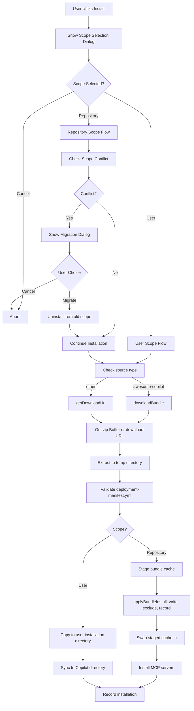
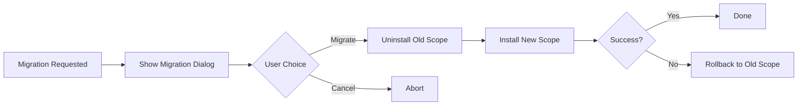
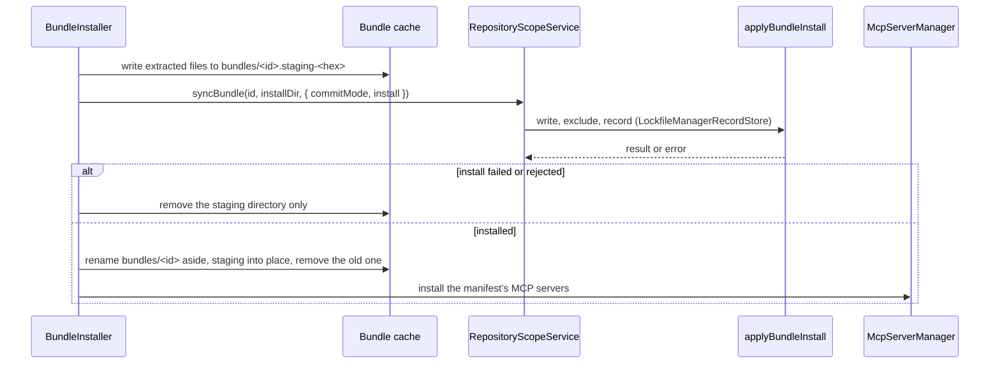
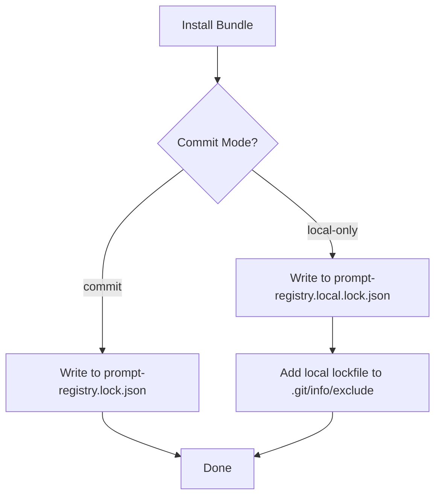
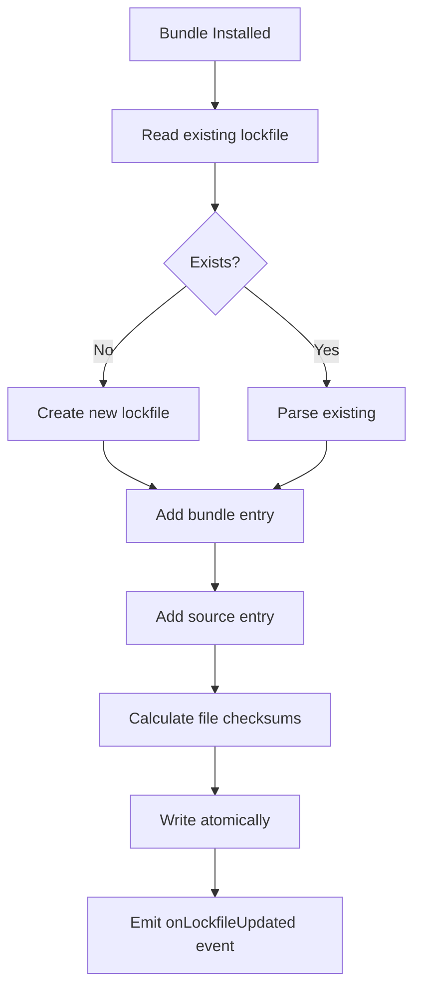
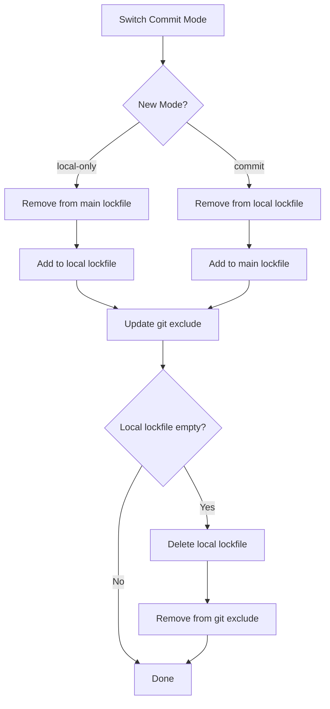
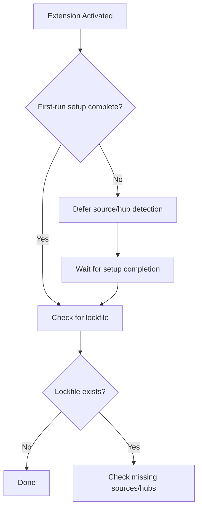
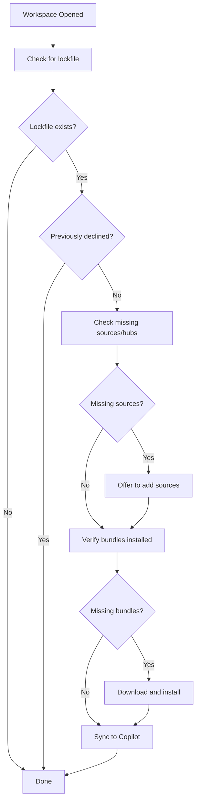

# Installation Flow

## Directory Structure

### User Scope

```
Extension Storage/
├── bundles/                          # Installed bundles
│   └── testing-automation/
│       ├── deployment-manifest.yml
│       └── prompts/
│           └── testing-prompt.prompt.md
└── registry.json                     # Sources and records

Copilot Directory (macOS)/
~/Library/Application Support/Code/User/prompts/
└── testing-automation/
    └── testing-prompt.prompt.md
```

### Repository Scope

```
your-repo/
├── .github/
│   ├── prompts/
│   │   └── my-prompt.prompt.md
│   ├── agents/
│   │   └── my-agent.agent.md
│   ├── instructions/
│   │   └── my-instructions.instructions.md
│   └── skills/
│       └── my-skill/
│           └── skill.md
├── .vscode/
│   └── mcp.json                      # MCP server configurations
├── prompt-registry.lock.json         # Main lockfile for committed bundles
└── prompt-registry.local.lock.json   # Local lockfile for local-only bundles (git-excluded)
```

## Installation Steps



## Planned Security Gate for Custom Sources

The scanner is currently an explicit CLI and extension workflow, not an
automatic installation gate. A future policy-controlled gate must scan
extracted bytes after manifest/integrity validation and before writing target
files, MCP configuration, lockfiles, or installation records. It must reuse the
shared scanner contract and explicitly distinguish report-only, warning, and
blocking policies. See [Security Scanner Architecture](./security-scanner.md).

## Binary Safety and Integrity Verification

Bundle files are copied to the target byte-for-byte and verified after every write:

- **Binary-safe writes** — writers use the `FileSystem` port's `readFileBytes`/`writeFileBytes` for all payloads. Text payloads (strict UTF-8) may additionally pass through a target-specific `ResourceTransformer`; binary payloads (images, archives, office documents) are never decoded as text — a lossy UTF-8 round-trip replaces invalid sequences with U+FFFD and corrupts them.
- **Post-write verification** — after each write, the installed file is re-read and compared against the bytes the writer intended to write (`verifyWrittenBytes` in `core`'s `domain/install/integrity`). A mismatch throws `FileIntegrityError` (`BUNDLE.INTEGRITY_MISMATCH`) instead of leaving a silently corrupted artifact.
- **Executable bits** (issue #577) — extractors tag each file's bytes with the permission bits its source recorded, using `withFileMode` (`ExtractedFile.mode`, `rwxrwxrwx` only): `ZipBundleExtractor` from the zip entry's Unix mode, `readLocalBundle` from `FileSystem.stat`. Map copies keep the mode; a byte copy drops it, which means "default mode". Both writers (`FileTreeTargetWriter`, `RepositoryScopeWriter`) call `applyFileMode` (`core`'s `domain/install/file-mode`) after each verified write; it calls the optional `FileSystem.setExecutable`. `NodeFileSystem.setExecutable` adds execute where read is granted (or clears every execute bit for a non-executable entry), never adds write or special bits, and does nothing on Windows. It is best effort: a `chmod` rejected with `EPERM`, `ENOTSUP`, `EOPNOTSUPP` or `EINVAL` (vfat/exFAT mounts, files owned by another user) leaves the mode unchanged instead of failing the install; other errors still propagate. Archives that resolvers synthesize with `buildZip` (`skills`, `awesome-copilot`) record `0644` for every entry. Filesystems without `setExecutable` (in-memory test doubles) keep today's behaviour; the extension's repository scope writes through `NodeFileSystem`, so plugin scripts keep their execute bit there as with the CLI. The lockfile records no mode.
- **Upstream layers already verified** — zip entry CRC-32 is checked during extraction, and governed (`formatVersion: 1`) deployment manifests carry per-file `size` + `sha256` validated against the extracted bytes.
- **Lockfile checksums** — `checksum` (`checksumFiles`) hashes the extracted (archive) bytes, not the optionally transformed on-disk result. Entries built by `buildLockfileBundleEntry` (CLI `install`, `update` and `profile activate`) also record `installedChecksum`, the hash of the bytes on disk, for each file whose on-disk bytes differ (see [Shared install and uninstall](#shared-install-and-uninstall-in-app)). The extension's repository-scope installs go through the same use case and record it too.

## Scope Selection

When a user initiates installation, a QuickPick dialog presents three options:

| Option | Scope | Commit Mode | Description |
|--------|-------|-------------|-------------|
| Repository - Commit to Git (Recommended) | `repository` | `commit` | Tracked in version control |
| Repository - Local Only | `repository` | `local-only` | Excluded via `.git/info/exclude` |
| User Profile | `user` | N/A | Available everywhere |

Repository options are disabled when no workspace is open.

## Scope Conflict Resolution

A bundle cannot exist at both user and repository scope simultaneously. When a scope migration is requested:

1. **Dialog**: User is prompted to migrate or cancel
2. **Migration**: `ScopeConflictResolver.migrateBundle()` uninstalls from the old scope and installs at the new scope
3. **Rollback**: If installation at the new scope fails, the resolver automatically attempts to restore the bundle at the original scope



## Install Categories

Every primitive kind belongs to one install category, defined in core (`packages/core/src/domain/install/category.ts`, see ADR-0009 in [#559](https://github.com/AmadeusITGroup/ai-primitives-hub/pull/559)):

| Category | Kinds today | Unit |
|----------|-------------|------|
| `file` | every kind not listed below, including `power` and `spec` | The item file |
| `directory` | `skill`, `plugin` | The whole directory of the item file |
| `config` | `mcp-server` | An entry in a target config file; `mcp-server` items are not installed yet |

A `directory` item is installed as one unit:

- `bundle build` archives every file below `dirname(item.path)`, and the item id is that directory name.
- VS Code and Copilot repository-scope installs copy that whole tree to `.github/<skills|plugins>/<id>/`. Bundle files are matched by whole path segment, so a skill `foo` never picks up the files of a skill `foo-bar`.

The category drives both `bundle build` packaging and repository-scope placement. A new kind whose category is already handled needs its row in the category table and a route in the target layouts that support it.

## Repository Scope Installation

### File Placement

Files are placed in `.github/` subdirectories based on type:

| File Type | Target Directory |
|-----------|------------------|
| Prompts (`.prompt.md`) | `.github/prompts/` |
| Instructions (`.instructions.md`) | `.github/instructions/` |
| Agents (`.agent.md`) | `.github/agents/` |
| Skills | `.github/skills/<skill-name>/` |
| Plugins | `.github/plugins/<plugin-name>/` |
| MCP Servers | `.vscode/mcp.json` |

### Git Exclude Management

For local-only mode, paths are added to the git exclude file through the `RepositoryExclusion` port; `GitInfoExclude` in `@ai-primitives-hub/infra` is the Git implementation. The shared install and uninstall use cases in `app` own these updates for every repository target type (see [below](#exclusion-ownership)); `RepositoryScopeWriter` still updates the file itself for the callers that have not moved yet (`install --lockfile` replay, `update`, `profile activate`).

```
# Prompt Registry (local)
.github/prompts/my-prompt.prompt.md
.github/agents/my-agent.agent.md
prompt-registry.local.lock.json
```

The local lockfile (`prompt-registry.local.lock.json`) is listed in the same exclude file and removed from it when the lockfile is deleted: `.git/info/exclude` in a plain repository, otherwise the exclude file `GitInfoExclude` resolves from the gitdir (the main repository's for a linked worktree, `.git/modules/<name>/info/exclude` for a submodule; see [Exclusion Ownership](#exclusion-ownership)). The CLI adds it on every local-only install, so a local lockfile an earlier version left out of the exclude file is added too.

This file is local to the user's machine and not committed to Git.

## Shared Install and Uninstall in `app`

The CLI and the VS Code extension's repository scope install and uninstall bundles through one path in `@ai-primitives-hub/app` (`packages/app/src/install/`), so both place the same files and write the same lockfile entry (see [Extension Repository Scope](#extension-repository-scope)). The extension's user and workspace scopes still use their own services.

| Module | Role |
|--------|------|
| `target-writer-factory.ts` | `createTargetWriterFactory` picks the writer for a target: `RepositoryScopeWriterAdapter` for `vscode`, `vscode-insiders` and `copilot-cli` at repository scope, `FileTreeTargetWriter` otherwise |
| `lockfile-entry.ts` | `buildLockfileBundleEntry` and `computeInstalledChecksums`: the one entry shape every write site records |
| `../stores/install-record-store.ts` | `createLockfileRecordStore`: install records over the two repository lockfiles or the user lockfile |
| `recorded-files.ts` | `locateRecord`, `removeGuarded`, `pruneEmptyParents`: where a record's files are and their guarded removal |
| `apply-bundle-install.ts` | `applyBundleInstall`: write, exclude, record, remove superseded files |
| `apply-bundle-uninstall.ts` | `applyBundleUninstall`: guarded removal, pruning, un-exclusion, record removal |

`install <bundle-id>`, `install --from` and `install --source` call `applyBundleInstall`; `uninstall` calls `applyBundleUninstall` through `UninstallPipeline` at repository scope and directly at user scope. `update` and `profile activate` build their entries with `buildLockfileBundleEntry` and their writers with the same factory.

### Recorded Locations and Containment

A lockfile entry is user-editable, so a recorded path is never joined onto the workspace as-is. Each writer implements `TargetWriter.locate`, which maps recorded files to absolute locations with `resolveRecordedLocation` (`core`'s `domain/install/recorded-location.ts`):

1. a recorded `installedPath` resolves below the writer's root;
2. otherwise the layout route matching the bundle path places the file;
3. otherwise, at repository scope, a legacy workspace-relative entry (`.github/prompts/x.prompt.md`) is accepted when it starts with the host's dot directory and lies below the root (`@migration-cleanup(lockfile-workspace-paths)`);
4. otherwise the file has no location (`null`).

`resolveContained` refuses empty, `.`, absolute, drive, UNC and `..`-escaping paths. A record is located with the writer of its `targetType` (the caller's type when absent); an unknown type, or a writer that throws, makes the record unresolvable and nothing is removed. For a record of another type, the writer gets the caller's name, scope and root, but not its `path` or `allowedKinds`: those belong to the caller's type. The entry records no target `path`, so a record placed through a target with a custom `path` is located, through a target of another type, at its type's default base directory.

`removeGuarded` then checks each location by real path through the optional `FileSystem.realpath` (`NodeFileSystem` uses `fs.realpath.native`): the file's parent directory must resolve to the root's real path or below it, so a symlinked directory below the root that points outside is refused. Without `realpath` (in-memory test doubles) the check is lexical only. A location another record holds is kept (`shared`); a missing file is reported as `missing`; with `preserveModified`, a file whose bytes no longer match `installedChecksum ?? checksum` is kept (`modified`; the CLI passes `false`). `pruneEmptyParents` then removes the ancestors of removed files that are left empty, deepest first, strictly below the root's real path. Superseded files on reinstall and on `update` go through the same guard (`removeSupersededRecordFiles`).

### Exclusion Ownership

The use cases, not the writers, update the exclusion list for `local-only` installs at repository scope, on every target type. The CLI and the extension (`createExtensionWriterFactory` in `apps/vscode-extension/src/services/app-install-context.ts`) build their repository writers with `writerOwnsExclusion: false` (`NO_EXCLUSION` in `RepositoryScopeWriter`) and pass a `GitInfoExclude` to the use cases; the record store adds and removes the local lockfile line (`LockfileManager` in the extension).

`GitInfoExclude` resolves the exclude file from `<workspace>/.git` on each call: a directory with `HEAD`, `objects` and `refs` (the entries Git requires of a repository directory) means `.git/info/exclude`; a file with a `gitdir:` line (linked worktree, submodule) means `<commondir or gitdir>/info/exclude`, so a worktree writes the main repository's file and a submodule `.git/modules/<name>/info/exclude`. Lines stay relative to the work tree, escaped so that each matches only its own path: `*`, `?`, `[`, `]` and `\`, a leading `!` or `#`, and trailing spaces get a `\` (`.kiro/steering/\[draft\].md`). `remove` also drops the unescaped line earlier versions wrote for the same path. Without a usable `.git` (none, a directory missing one of those entries, or a `gitdir:` link to a directory that no longer exists, as after a pruned worktree), `isAvailable()` is `false`: the use cases report `exclusionSkipped` and no `.git` is created. Exclusion failures are reported in `exclusionErrors` and never fail the install or uninstall.

### Install Steps

`applyBundleInstall` reads the previous record, writes the bundle (`writeBundleForInstall`, all-or-nothing unless `skipUnsupported`), excludes the written files when `local-only`, computes `installedChecksum`s and stores the entry. A failure while recording rolls the write back and removes the exclusion lines it added, then rethrows: the built-in writers report the bytes each destination held before the write (`TargetWriteResult.replaced`, taken with core's `snapshotBeforeWrite`), so a file the write overwrote gets those bytes back and a file it created is removed; with a writer that reports nothing replaced, files the previous record owns are kept. Afterwards it locates the previous record with the writer of its own `targetType`, removes that record's files the new entry does not produce (guarded as above), prunes, and un-excludes them; switching from `local-only` to `commit` un-excludes the new locations. A store keeps one record per bundle id, so a reinstall through another target type replaces the record and removes the previous type's files the same way. When a previous record of another type can't be located, its files stay and are reported in `supersededKept` as `unresolvable`, with the reason in `supersededUnresolvable`.

### Extension Repository Scope

At repository scope the extension's `RepositoryScopeService` is a thin delegator (`apps/vscode-extension/src/services/`):

| Method | Delegates to | Wiring |
|--------|--------------|--------|
| `syncBundle(bundleId, path, { commitMode, install })` | `applyBundleInstall` | `preserveModified: true`; throws when `install` (the extracted files, manifest, origin and source) is missing |
| `preflightBundle` | `planBundleInstall` | Same target and files, writes nothing |
| `unsyncBundle` | `applyBundleUninstall` | `preserveModified: true`; errors are rethrown |
| `switchCommitMode` | `LockfileManager.updateCommitMode`, then `switchRecordedCommitMode` | Moves the entry, then adds or removes the recorded locations in the exclude file |

Every call gets `createExtensionWriterFactory(workspaceRoot)` (project `ai-primitives-hub-layouts.yml` read, user layouts file not read), the host target from `repositoryTarget(workspaceRoot, commitMode, detectHostApp())`, a `LockfileManagerRecordStore` over `LockfileManager.getInstance(workspaceRoot)`, a `GitInfoExclude` and `NodeFileSystem`. The extension does not pass `skipUnsupported`, so content the host cannot install raises `TargetWriteRejectedError`; `BundleInstaller` rethrows it as `Cannot install "<name>" on <targetType> (repository scope): <message>` with `code` `BUNDLE.UNSUPPORTED_CONTENT` and the rejected bundle paths in `unsupported`. `exclusionSkipped` is logged once as `No git repository at <workspace>; local-only files are not excluded from git`.

`BundleInstaller.installFromBuffer` keeps the bundle cache (`bundles/<id>` under the extension's global storage) consistent with the repository files by staging it:



The swap retries a rename up to three times on `EPERM`/`EBUSY` (back-off of 100 ms times the attempt number) and restores the old cache when it fails, throwing `Installed "<name>" but could not update its cache (<message>); reinstall the bundle`. Leftover `.staging-*` and `.old-*` directories of an interrupted install are removed before the next one.

`BundleInstaller.update` at repository scope stages the new version, calls `preflightBundle`, and only then uninstalls the installed version through the shared uninstall and runs `syncBundle`, so a version the host cannot install leaves the installed one untouched. A failure after the preflight (for example a lockfile write) has already removed the old version; the new files are rolled back. `uninstall` passes `{ scope }` to `unsyncBundle`; the record store removes the lockfile entry.

User and workspace scope keep their order: cache write, MCP servers, then `UserScopeService.syncBundle`, which returns `undefined`.

## Lockfile Management

The `LockfileManager` singleton manages repository-scoped bundles using a dual-lockfile architecture:

| Lockfile | Purpose | Git Tracking |
|----------|---------|--------------|
| `prompt-registry.lock.json` | Committed bundles | Tracked (commit to Git) |
| `prompt-registry.local.lock.json` | Local-only bundles | Excluded via `.git/info/exclude` |

### Dual-Lockfile Architecture

Bundles are stored in separate lockfiles based on their commit mode:

- **Committed bundles** → `prompt-registry.lock.json` (shared with team)
- **Local-only bundles** → `prompt-registry.local.lock.json` (personal, git-excluded)

The commit mode is **implicit** based on which lockfile contains the bundle—no `commitMode` field is stored in bundle entries.



### Single Source of Truth

The lockfile is the **single source of truth** for repository-scoped bundles:

- `RegistryManager.listInstalledBundles('repository')` queries both lockfiles
- Repository-scoped installations only update the appropriate lockfile, not `RegistryStorage`
- User/workspace-scoped bundles continue to use `RegistryStorage`
- When listing bundles, `LockfileManager` merges entries from both lockfiles and annotates each with its commit mode

This prevents inconsistencies when lockfile or bundle files are manually deleted.

### File Existence Validation

When listing repository bundles, the extension validates that bundle files exist:

- Each entry is located with the writer of its `targetType` (`locateRecord`) and compared with the disk by `inspectRecordedFiles`, the same rules the uninstall uses; `detectModifiedFiles` reads the same inspection
- If files are missing, the bundle is marked with `filesMissing: true`; an entry whose recorded path resolves outside the target root (the `../` bundle-cache paths earlier versions recorded for plugins) counts as missing
- The UI shows a warning indicator for bundles with missing files
- Use the "Clean Up Stale Repository Bundles" command to remove stale entries

### Creation/Update



### Atomic Write

Lockfile writes use a temp file + rename pattern to prevent corruption:

1. Write to `prompt-registry.lock.json.tmp`
2. Rename to `prompt-registry.lock.json`

### Lockfile Schema

Both lockfiles, and the CLI's user lockfile, use the same schema (`packages/core/src/public/schemas/lockfile.schema.json`). The `commitMode` field is deprecated and read-only: commit mode is implicit based on file location, and no writer includes it in new entries.

Bundle entry fields beyond the example below, written by `buildLockfileBundleEntry`:

| Field | Where | Meaning |
|-------|-------|---------|
| `targetType` | bundle entry | Target type that placed the files; used to locate them on uninstall and reinstall |
| `installedPath` | file entry | Location relative to the target's base directory, only when it differs from the route |
| `installedChecksum` | file entry | SHA-256 of the bytes on disk, only when they differ from `checksum` (the target transformed the file) |

A file entry's `path` is bundle-relative; entries written by earlier extension versions may be workspace-relative (`.github/prompts/…`) and are still read.

```json
{
  "$schema": "...",
  "version": "1.0.0",
  "generatedAt": "2026-01-14T10:30:00.000Z",
  "generatedBy": "prompt-registry@1.0.0",
  "bundles": {
    "bundle-id": {
      "version": "1.0.0",
      "sourceId": "github-a1b2c3d4e5f6",
      "sourceType": "github",
      "installedAt": "...",
      "targetType": "vscode",
      "files": [
        { "path": "prompts/...", "checksum": "sha256..." }
      ]
    }
  },
  "sources": {
    "github-a1b2c3d4e5f6": { "type": "github", "url": "..." }
  },
  "hubs": {
    "b5c6d7e8a9f0": { "name": "My Hub", "url": "https://example.com/hub.json" }
  }
}
```

> **Note:** Existing lockfiles with `commitMode` field continue to work for backward compatibility. The field is ignored on read (file location determines mode) and not included in new entries.

### SourceId Generation

SourceIds uniquely identify sources in the lockfile. The format depends on the source origin:

| Source Origin | Format | Example |
|---------------|--------|---------|
| Hub source | `{type}-{12-char-hash}` | `github-a1b2c3d4e5f6` |
| Non-hub source | `{source.id}` | `my-local-source` |

For hub sources, the sourceId is generated using `generateHubSourceId(type, url)` from `src/utils/sourceIdUtils.ts`:

1. Normalize the URL (lowercase, remove protocol, remove trailing slashes)
2. Hash `{type}:{normalizedUrl}` using SHA256
3. Take the first 12 characters of the hex digest
4. Format as `{type}-{hash}`

This ensures:
- **Determinism**: Same source always produces the same ID
- **Portability**: SourceIds don't depend on hub configuration
- **Collision resistance**: 12 hex chars (48 bits) provides sufficient uniqueness

**Legacy format**: Older lockfiles may contain hub-prefixed sourceIds (`hub-{hubId}-{sourceId}`). These continue to work for backward compatibility—sources are resolved by matching the sourceId in the `sources` section.

**Case normalization (v2)**: Source IDs generated after this version use fully case-insensitive URL normalization (host + path lowercased). Older source IDs preserved path case. The extension uses dual-read: when matching source IDs, it checks both current and legacy formats. Lockfile entries with old-format IDs continue to work and migrate organically when bundles are updated. Local data (config.json, cache) is migrated automatically on activation via `MigrationRegistry`. All migration-related code is tagged with `@migration-cleanup(sourceId-normalization-v2)` for future removal.

### Orphaned Hub Source Pruning

Because a hub source's sourceId is derived from its URL, renaming a collection's repository URL produces a *new* sourceId while the old source lingers—causing the same collection to appear twice in the registry.

When syncing a hub, `loadHubSources` (in `@ai-primitives-hub/app`, `registry/load-hub-sources.ts`) tracks which existing sources are still represented in the current hub config (added, updated, or matched as a duplicate). Any source whose `hubId` matches the hub being loaded but is absent from that set is treated as orphaned. Manually-added sources (no `hubId`) and sources contributed by other hubs are never touched. The returned `LoadHubSourcesResult` includes a `removed` count alongside `added`/`updated`/`skipped`.

Orphan handling depends on whether installed bundles reference the orphan:

- **No consumers:** the orphan is removed via `HubSourceSync.removeSource`.
- **Has consumers + `remapBundleSource` provided:** lockfile entries and installation records are remapped to the replacement source (the new sourceId from the renamed URL), then the orphan is removed. This ensures bundles continue receiving updates from the new source seamlessly.
- **Has consumers + no `remapBundleSource`:** the orphan is kept alive with a warning, preventing bundles from becoming unmanaged.
- **Any `addSource` failure this sync:** pruning is skipped entirely to avoid deleting an old source before its replacement lands.

### Hub Key Generation

Hub entries in the lockfile use URL-based keys instead of user-defined hub IDs:

```json
"hubs": {
  "b5c6d7e8a9f0": { "name": "My Hub", "url": "https://example.com/hub.json" }
}
```

The key is generated using `generateHubKey(url, branch?)`:
- Hash the normalized URL using SHA256
- Take the first 12 characters
- Append `-{branch}` if branch is not `main` or `master`

This makes lockfiles portable across different hub configurations.

### Commit Mode Switching

When switching a bundle between commit and local-only modes:



All bundle metadata (version, sourceId, files, etc.) is preserved during the move. `RepositoryScopeService.switchCommitMode` moves the entry with `LockfileManager.updateCommitMode`, then `switchRecordedCommitMode` (`app`) locates the recorded files with the writer of the entry's `targetType` and adds them to or removes them from the exclude file; only the recorded files are touched.

### Backward Compatibility and Migration

The dual-lockfile architecture maintains backward compatibility with existing lockfiles:

| Scenario | Behavior |
|----------|----------|
| Read lockfile with `commitMode` field | Field is ignored; file location determines mode |
| Write new bundle entry | `commitMode` field is not included |
| Update existing entry | Entry is rewritten without `commitMode` field |
| Local-only bundle in main lockfile | Continues to work; migrates on next modification |

**Migration path for existing lockfiles:**

1. Existing lockfiles with `commitMode` field continue to function normally
2. When a bundle is modified (updated, mode switched), the entry is rewritten without `commitMode`
3. Local-only bundles in the main lockfile remain there until explicitly switched to local-only mode
4. No automatic migration is performed—changes happen gradually as bundles are modified

**Conflict detection:**

If a bundle ID exists in both lockfiles (should not happen in normal operation), `LockfileManager.getInstalledBundles()` displays an error to the user and skips the duplicate entry from the local lockfile.

## Repository Activation

When a workspace with a lockfile is opened, the extension checks for missing sources and hubs. This detection is **deferred until first-run setup is complete** to avoid confusing users with source configuration prompts before they've configured the extension.

### Setup Timing



The `RepositoryActivationService` accepts a `SetupStateManager` dependency:
- If setup is incomplete, detection is deferred and logged
- If `SetupStateManager` is unavailable, detection proceeds (fail-open behavior)
- After setup completes, detection is triggered automatically

### Activation Flow



## AwesomeCopilot Flow

1. Fetch `collection.yml` from GitHub
2. Parse collection items
3. Fetch each prompt file (with auth)
4. Create `deployment-manifest.yml` (YAML)
5. Build zip archive in memory
6. Return Buffer to BundleInstaller

## Bundle Manifest

```yaml
# deployment-manifest.yml
version: "1.0"
id: "my-bundle"
name: "My Bundle"
prompts:
  - id: "my-prompt"
    name: "My Prompt"
    type: "prompt"
    file: "prompts/my-prompt.prompt.md"
    tags: ["example"]
```

## Key Components

| Component | Responsibility |
|-----------|----------------|
| `ScopeServiceFactory` | Returns appropriate scope service based on `InstallationScope` |
| `UserScopeService` | Handles user-level file placement and Copilot sync |
| `RepositoryScopeService` | Delegates repository-scope install, uninstall, preflight and commit-mode switches to the `app` use cases |
| `LockfileManagerRecordStore` | `InstallRecordStore` over the extension's two repository lockfiles |
| `LockfileManager` | Manages lockfile CRUD operations |
| `ScopeConflictResolver` | Detects and handles scope conflicts |
| `RepositoryActivationService` | Handles lockfile detection on workspace open |
| `LocalModificationWarningService` | Detects local file changes before updates |
| `BundleScopeCommands` | Context menu commands for scope management |

## See Also

- [Adapters](./adapters.md) — URL vs Buffer installation
- [MCP Integration](./mcp-integration.md) — MCP server installation
- [Update System](./update-system.md) — Update checking and application
