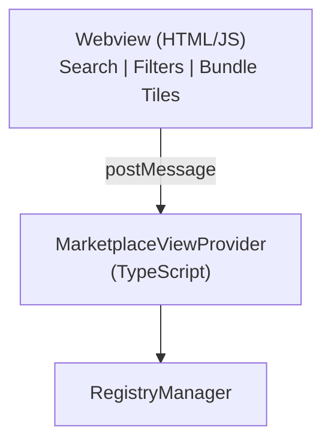
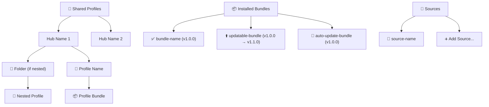
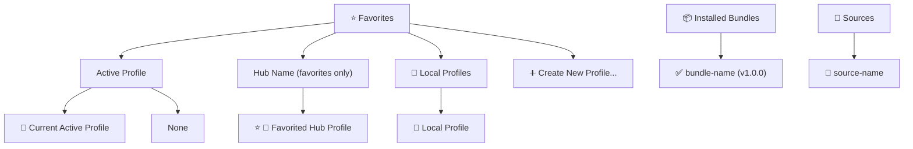

# UI Components

## Marketplace View

WebView-based marketplace with tiles, search, and filters.

### Architecture

### Message Types

| Message | Direction | Purpose |
|---------|-----------|---------|
| `bundlesLoaded` | Host → Webview | Send bundle data |
| `refresh` | Webview → Host | Refresh bundle list |
| `install` | Webview → Host | Install bundle |
| `installVersion` | Webview → Host | Install specific version |
| `update` | Webview → Host | Update bundle |
| `uninstall` | Webview → Host | Uninstall bundle |
| `openDetails` | Webview → Host | Open bundle details |
| `openPromptFile` | Webview → Host | Open prompt file |
| `getVersions` | Webview → Host | Get available versions |
| `toggleAutoUpdate` | Webview → Host | Toggle auto-update |
| `openSourceRepository` | Webview → Host | Open source repo |
| `openExternalLink` | Webview → Host | Open a README link externally (prompts user) |

### Interaction Flow

1. User opens Marketplace
2. `resolveWebviewView()` called
3. `searchBundles({})` fetches bundles
4. `postMessage({type: 'bundlesLoaded'})` sends to webview
5. Webview renders tiles
6. User clicks Install → `postMessage({type: 'install'})`
7. Host calls `RegistryManager.installBundle()`
8. Success → refresh tiles with installed badge

### Content Breakdown

Each bundle in `bundlesLoaded` carries a `contentBreakdown` (`ContentBreakdown` in `utils/filter-utils.ts`): counts of prompts, instructions, chat modes, agents, skills, plugins and MCP servers. `MarketplaceViewProvider.getContentBreakdown` takes the counts from core, without a per-type switch of its own:

1. When the installed manifest declares an item list (`items` or `prompts`, even an empty one) or any items, core `countManifestItemsByKind` counts them by primitive kind. It reads the items through core `manifestItems`: only the canonical `items[]` for a `formatVersion: 1` manifest, otherwise `items[]` followed by the legacy per-type lists (`prompts`, `agents`, `instructions`, `hooks`, `plugins`, `skills`). A legacy entry without a `type` gets its list's kind.
2. Otherwise, the same count runs over bundle data that embeds `items` or `prompts`. The GitHub adapter copies `items`, `formatVersion` and `prompts` from the release manifest onto the bundle; the local adapter copies `items` and `formatVersion`. `formatVersion` keeps a governed release's `prompts` projection from being counted twice.
3. Otherwise, the adapter's pre-computed `breakdown` or a `skills` array is used, and the counts are zero when neither is present.

`contentBreakdownFromKindCounts` maps the kind counts onto `ContentBreakdown` fields. Kinds without a field (hooks, steering, …) are not shown. MCP servers are counted from the manifest's `mcpServers` map.

The webview's **Primitives** filter ids are the `ContentBreakdown` fields (`agents`, `skills`, `prompts`, `mcpServers`, `instructions`, `plugins`), so the filter selects a bundle when the selected field is non-zero. Cards and the details panel show a Plugins count with the `fa-plug-circle-check` icon; breakdown icons are `aria-hidden` because the text label carries the meaning. Display nouns for kinds ("Plugin", "MCP server", …) come from `utils/primitive-kind-labels.ts`, keyed by core's `PrimitiveKind`, so a new kind does not compile until it has a label.

### README Rendering

Bundle README markdown is rendered to HTML in the details panel via `markdown-it` and sanitized with `sanitize-html` (`getMarkdownRender`). Links (`<a>`) are preserved and tagged with a `data-external-link` attribute. The details webview intercepts clicks on these links and sends an `openExternalLink` message; the host then prompts the user for confirmation before opening the URL with `vscode.env.openExternal`. Images remain HTTPS-only to match the webview CSP; links may use `https`, `http`, or `mailto`.

### Progressive Loading on Source Sync

Sources sync in parallel (`Promise.allSettled`), and each fires `RegistryManager.onSourceSynced` as its bundles are cached — large skills sources stream multiple partial batches as they parse. The marketplace renders bundles as soon as **any** source has cached them, rather than waiting for all sources to finish. Two mechanisms cooperate in `MarketplaceViewProvider`:

- **`handleSourceSynced` throttle (leading + trailing, 500ms)** — the leading edge renders immediately when a burst starts; the trailing edge picks up whatever arrived during the window. This rate-limits renders to avoid flicker when a source streams many partial batches.
- **`loadBundles` coalescing** — `loadBundles` reads the full cache (`searchBundles({ cacheOnly: true })`) and posts one `bundlesLoaded` message. If it is called while a load is already in flight (e.g. the throttle's trailing edge racing the 100ms bootstrap load or the webview's self-`refresh`), it sets a pending flag and re-runs exactly once when the current load finishes, instead of dropping the request. This guarantees the latest cache always renders — without it, the first source's bundles could stay hidden until a later source re-armed the throttle.

## Tree View

Hierarchical view displaying profiles, bundles, and sources with two view modes: "All Hubs" and "Favorites".

### Structure

The tree view has two modes controlled by `toggleViewMode()`:

#### All Hubs Mode (Default)

#### Favorites Mode

### Components

| Component | Responsibility |
|-----------|---------------|
| **RegistryTreeProvider** | Main tree data provider implementing `vscode.TreeDataProvider<RegistryTreeItem>` |
| **RegistryTreeItem** | Individual tree nodes extending `vscode.TreeItem` with type, data, and context |
| **TreeItemType** | Enum defining 20+ node types (profiles, hubs, bundles, sources, folders, etc.) |

### Key Features

#### View Mode Toggle
- **All Hubs Mode**: Shows all imported hubs and their profiles
- **Favorites Mode**: Shows only favorited profiles, active profile section, and local profiles
- Toggle via `promptRegistry.toggleProfileView` command in view title

#### Bundle Status Indicators
- **✅**: Installed bundle (up-to-date)
- **⬆️**: Update available
- **🔄**: Auto-update enabled
- Version display shows current version or "current → latest" when updates available

#### Installed Bundle Tooltip

An installed bundle's tooltip shows its version and install date, followed by a `Contains:` line listing its non-zero item counts in core `PRIMITIVE_KINDS` order (for example `Contains: 1 prompt, 1 plugin`). The counts come from core `countManifestItemsByKind` over the installed manifest and are formatted by `formatKindCounts` (`utils/primitive-kind-labels.ts`). Installed bundles stay leaves (`TreeItemCollapsibleState.None`).

The line is omitted when the installed manifest declares no items. This is the case for repository-scope bundles today: they are rebuilt from the lockfile with a minimal manifest that has no item list. Bundles whose files are missing keep their warning tooltip instead.

#### Hub Source Loading Progress
- `LoadHubSourcesOptions.onProgress` reports bounded, monotonic source-work percentages. Registration-only loads use one unit per declaration; progressive loads reserve two fixed units per declaration (registration and sync). Skips, updates and registration failures settle the unused sync unit; sync failures also settle their work. Empty hubs report 0% then 100%. Observer exceptions are isolated from loading.
- `HubManager.getHubLoadingProgress()` and `onHubLoadingProgressChanged` expose transient per-hub state for import, activation and source reloads. Run tokens reject stale updates/cleanup from overlapping runs; completion/failure clears state even when callers do not await the final milestone.
- `RegistryTreeProvider` coalesces progress refreshes with its existing leading/trailing throttle. Hub rows show whole-number percentage text in the description after the label, leaving the hub icon unchanged. `[Active]` remains visible throughout loading for the selected hub (for example, `[Active] 25%`); the active context value remains unchanged for menu actions. Recreated rows remove the percentage once progress is absent.
- Both All Hubs and Favorites apply `[Active]` and the `hub_active` menu context before appending progress. Active-hub changes refresh immediately, including when source loading is disabled or no sources are available; the provider disposes this subscription with its other listeners.
- After deleting an active hub, `HubManager` selects a remaining hub. If replacement listing or activation fails, it clears the deleted hub's stale selection through `setActiveHub()` so active-change observers are notified, without clearing a different concurrent selection. Successful storage deletion always emits `onHubDeleted`, even if replacement recovery fails. Bulk hub deletion is serialized so a promoted hub cannot remain selected after its subsequent deletion.

#### Profile Organization
- **Hub Profiles**: Organized by hub with folder structure support
- **Local Profiles**: User-created profiles stored locally
- **Active Profile**: Special section showing currently active profile
- **Favorites**: Star-marked hub profiles for quick access

#### Context Menus
Extensive right-click menus defined in `package.json` with context-sensitive actions:

| Context Value | Available Actions |
|---------------|-------------------|
| `profile`, `profile-active` | Activate, Deactivate, Edit, Export, Delete |
| `hub_profile` | Activate, Deactivate, Edit, Export, Delete, Toggle Favorite, Open Repository |
| `installed_bundle_*` | View, Update, Check Updates, Enable/Disable Auto-Update, Uninstall, Open Repository |
| `source` | Edit, Sync, Remove, Toggle, Open Repository |
| `hub` | Sync, Delete, Open Repository |

### Implementation Details

#### Tree Data Provider
- Implements `vscode.TreeDataProvider<RegistryTreeItem>`
- Registered as `promptRegistryExplorer` in `package.json`
- Supports collapse/expand states and refresh events
- Throttled refresh on source sync events (leading + trailing, 500ms); `refresh()` fires `onDidChangeTreeData` so VS Code re-queries lazily

#### Event Handling
Listens to multiple registry and hub manager events:
- Bundle events: installed, uninstalled, updated
- Profile events: activated, deactivated, created, updated, deleted
- Source events: added, removed, updated, synced
- Hub events: imported, deleted, synced, favorites changed, active hub changed, loading progress changed (throttled)

#### Update Detection
- Tracks available updates via `onUpdatesDetected()`
- Maps bundle IDs to `UpdateCheckResult` objects
- Updates tree icons and descriptions when updates available
- Integrates with auto-update preferences

#### Tree Item Types
20+ distinct `TreeItemType` enum values including:
- Root sections: `PROFILES_ROOT`, `HUBS_ROOT`, `FAVORITES_ROOT`, `INSTALLED_ROOT`, `SOURCES_ROOT`
- Profile items: `PROFILE`, `HUB_PROFILE`, `PROFILE_BUNDLE`, `CREATE_PROFILE`
- Bundle items: `INSTALLED_BUNDLE`, `BUNDLE`
- Hub items: `HUB`, `PROFILE_FOLDER`, `LOCAL_PROFILES_FOLDER`
- Source items: `SOURCE`, `ADD_SOURCE`
- Discovery items: `DISCOVER_ROOT`, `DISCOVER_CATEGORY`, etc.

## See Also

- [Installation Flow](./installation-flow.md) — What happens on install
- [User Guide: Marketplace](../../user-guide/marketplace.md) — User documentation
