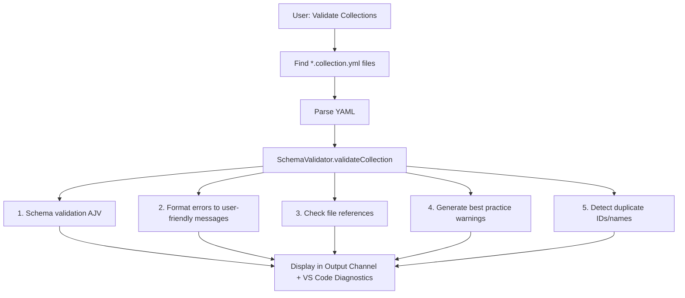
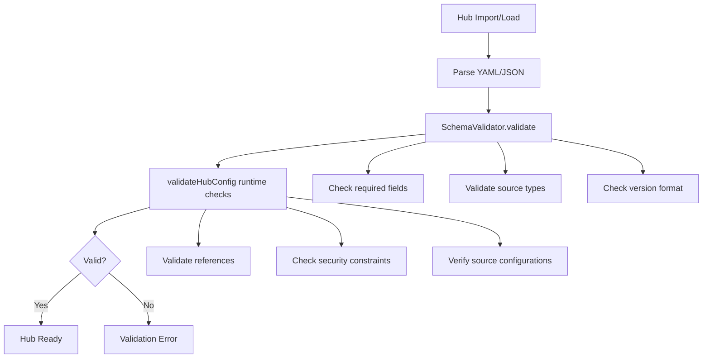

# Validation Architecture

JSON Schema validation for collections, APM packages, and hub configurations.

## Shared CLI and CI Governance

Governance extends the existing CLI validation commands rather than supplying a separate executable. Delivery code chooses legacy validation or governance based on the explicit `--governance`, `--policy`, `--min-score`, and `--report-path` options. Legacy invocations retain their prior output and behavior.

- **Core (`domain/governance/`):** `types.ts`; `rule-registry.ts` (every rule id, subjects, default severity, floor/configurable/network flags); `rules/` (`collection.ts` COL001–COL006, `hub.ts` HUB001–HUB002, `primitive.ts` skill/agent/prompt/instruction/MCP content rules, `config.ts` CFG002–CFG004); `floor.ts`, `effective-rules.ts`, `score.ts`, `evaluate.ts` (verdict) and `catalogue.ts`. Ports: `release-lookup.ts`, `hub-collection-index.ts`, `schema-validator.ts`, `argv-process-runner.ts`. The consumer schema is `public/schemas/hub-governance.schema.json`; `scripts/assert-schemas.mjs` fails the build if a schema is missing from `dist`. `COLLECTION_ID_PATTERN` (in `domain/collection/validate.ts`) is the single collection-id pattern; tests pin it to `collection.schema.json` and to `lib`.
- **Infrastructure (`governance/`):** `ajv-schema-validator.ts` (the `SchemaValidator` adapter, also used by the VS Code extension's `SchemaValidator` service), `governance-config.ts` (YAML + schema, CFG001), paginated GitHub release lookup with an ids-only mode for context sources, and strict collection inventories with a worker pool and an overall deadline. Strict Awesome Copilot reads bypass tolerant caches and fail rather than silently dropping malformed definitions.
- **App (`governance/`):** `load-config.ts` (discovers `hub-governance.yml`; PR-scoped runs read it from the merge base), `run-governance.ts` (hub and primitive subjects), `validate-collection-governance.ts`, `hub-scoped-governance.ts`, `primitive-governance.ts` (local files and fetched bundles), `report.ts` and `generate-catalogue.ts`. Regenerate `docs/author-guide/rule-catalogue.md` with `pnpm -C packages/app run generate:rule-catalogue`; a test fails when it is stale.
- **CLI:** existing commands delegate to app and use the established output formatter and injected filesystem for reports.
- **Existing collection action:** uses focused `@ai-primitives-hub/app/governance` and `@ai-primitives-hub/infra` governance/filesystem/HTTP entry points. These keep unrelated search/WASM out of its self-contained Rollup bundle.
- **Reusable workflow:** executes the standard CLI with governance options, then publishes artifacts, optional bot comments, and the final gate.

Governance remains offline by default. Collection `--check-releases` or Hub governance `--check-sources` explicitly enables source mode. App composes existing adapter/auth routing, and core consumes evidence through `ReleaseLookup` and `HubCollectionIndex`. Unverified data fails the gate without reducing the score; it is never promoted to a verified missing release or clean inventory. Legacy deep Hub validation remains separate for full profile/version resolution. Policy and scoring must not silently trigger network access. See [provider governance](https://github.com/AmadeusITGroup/ai-primitives-hub/blob/main/.github/scripts/hub-governance/README.md) for CI contracts and release checks. The reusable workflow owns CLI installation, standard validation arguments, report publication and the final gate; its scripts isolate execution and report results without defining another validation API or custom action.

## Components

| Component | Responsibility |
|-----------|---------------|
| **SchemaValidator** | JSON schema validation using AJV |
| **ValidateCollectionsCommand** | Command handler for collection validation |
| **ValidateApmCommand** | Command handler for APM package validation |
| **HubManager** | Hub configuration validation and runtime checks |
| **validateAgentPluginItem** | Pure Agent Plugins 1.0.0 `plugin.json` checks plus the plugin-root rule (`packages/core/src/domain/plugin/agent-plugin-spec.ts`). Wired by app `validateCollectionFile` for `kind: plugin` items: fatal issues become errors, non-fatal issues become warnings. Also wired by app `planBundleRelease` (`bundle build`) on the release tree it packages, read through `ReleaseSourceTree`, with the same messages (`app/src/collection/plugin-item-issues.ts`): fatal issues reject with `PLUGIN.INVALID_MANIFEST` before any archive is written, non-fatal issues become build warnings |
| **findKindRouteMismatch** | Pure kind/route comparison (`packages/core/src/domain/install/kind-route.ts`): the kind of the longest built-in layout route an item path matches, against the declared kind. Wired by app `validateCollectionFile` (`app/src/collection/kind-route-warning.ts`) over every built-in layout's routes, as a warning only; `doctor diagnostics --primitives` carries these warnings on the bundle's `I0` check |

## SchemaValidator API

```typescript
interface ValidationResult {
    valid: boolean;
    errors: string[];
    warnings: string[];
}

interface ValidationOptions {
    checkFileReferences?: boolean;
    workspaceRoot?: string;
}

class SchemaValidator {
    constructor(extensionPath?: string);
    async validate(data: any, schemaPath: string, options?: ValidationOptions): Promise<ValidationResult>;
    async validateCollection(data: any, options?: ValidationOptions): Promise<ValidationResult>;
    async validateApm(data: any, options?: ValidationOptions): Promise<ValidationResult>;
    clearCache(): void;
}

// Hub validation is handled by HubManager
class HubManager {
    async validateHub(config: HubConfig): Promise<ValidationResult>;
}
```

## Validation Flow



## Error Formatting

| Error Type | Example |
|------------|---------|
| Required field | `Missing required field: description` |
| Pattern mismatch | `/id: must match pattern ^[a-z0-9-]+$` |
| Enum violation | `kind: must be one of: prompt, instruction, agent, skill` |
| Type mismatch | `/version: must be string` |
| Length violation | `description: must be at most 500 characters` |
| Additional property | `/: has unexpected property 'foo'` |
| Duplicate ID | `Duplicate collection ID 'my-id' (also in other.collection.yml)` |
| Duplicate name | `Duplicate collection name 'My Name' (also in other.collection.yml)` |

## Performance

- **Schema Caching**: Compiled schemas cached in Map
- **Lazy Loading**: Schemas loaded on first use
- **File Reference Checking**: Always enabled for complete validation

## Validation Schemas

The extension provides JSON Schema validation for all major configuration file types. Each schema enforces structure, data types, and business rules specific to its component.

### Collection Schema

**Location:** `schemas/collection.schema.json`  
**Validates:** Copilot prompt collection files (`.collection.yml`)

**Required fields:**
- `id` — Unique identifier (lowercase letters, numbers, hyphens only)
- `name` — Human-readable collection name (1-100 characters)
- `description` — Detailed purpose description (1-500 characters)
- `items` — Array of collection resources (0-50 items)

**Optional fields:**
- `version` — Semantic version string
- `author` — Collection author information
- `tags` — Array of categorization tags
- `mcp` — Model Context Protocol server configurations
- `display` — UI display preferences (color, icon, ordering)

**Item types supported:** `prompt`, `instruction`, `agent`, `skill`

**Validation features:**
- File reference checking (when `checkFileReferences` enabled)
- Best practice warnings (long descriptions, empty collections, missing metadata)
- MCP server configuration validation

See [Author Guide: Collection Schema](../../author-guide/collection-schema.md) for complete reference.

### Agent Plugins Manifest Schema

**Location:** `packages/core/src/public/schemas/agent-plugins/1.0.0/plugin.schema.json` (exported as `AGENT_PLUGIN_MANIFEST_SCHEMA`)  
**Validates:** the root `plugin.json` of `kind: plugin` collection items

The schema is vendored unmodified from
[agentplugins/agent-plugins-spec](https://github.com/agentplugins/agent-plugins-spec/blob/d92e6f443b8edcea42c039727a82afdc565779e2/schemas/1.0.0/plugin.schema.json)
(Apache-2.0). Core has no JSON Schema engine, and the spec splits violations into
fatal and non-fatal, so the rules are hand-written in `validateAgentPluginManifest` /
`validateAgentPluginItem` and a parity test (`packages/core/test/domain/plugin/agent-plugin-spec.test.ts`)
asserts the constants match the vendored file.

**Validation features:**
- Fatal: unreadable / non-JSON / non-object manifest, missing or unsupported `$schema`, invalid `name`, wrongly typed standard fields, non-object `author`
- Non-fatal: unknown top-level fields, non-object `extensions` or extension entries
- APH packaging rule (fatal): the item path must be `<plugin-root>/plugin.json` below the repository root, and `name` must equal the plugin root's directory name, because bundling archives `dirname(item.path)` under that name
- Input is the item path and the manifest text; callers do the file IO, so the same checks can run on an authoring tree or an extracted archive

### APM Schema

**Location:** `schemas/apm.schema.json`  
**Validates:** APM (Awesome Prompt Manager) package manifests

**Required fields:**
- `name` — Package name (lowercase letters, numbers, dots, underscores, hyphens)
- `version` — Semantic version with optional pre-release suffix
- `description` — Package description (max 500 characters)
- `author` — Package author

**Optional fields:**
- `license` — License identifier
- `tags` — Array of tags (max 20 items, 30 characters each)
- `dependencies` — Package dependencies (`apm`, `mcp` arrays)
- `scripts` — Build/lifecycle scripts object

**Validation features:**
- Semantic version format enforcement
- Package name pattern validation
- Dependency structure validation

### Hub Configuration Schema

**Location:** `schemas/hub-config.schema.json`  
**Validates:** Hub configuration files that define bundle sources and profiles

**Required fields:**
- `version` — Semantic version of hub config format
- `metadata` — Hub metadata object
  - `name` — Hub name (1-100 characters)
  - `description` — Hub description (1-500 characters)
  - `maintainer` — Maintainer identifier (1-100 characters)
  - `updatedAt` — ISO 8601 timestamp
- `sources` — Array of bundle sources (minimum 1)

**Optional fields:**
- `profiles` — Predefined bundle collections
- `configuration` — Hub-level settings (autoSync, syncInterval, strictMode)
- `metadata.checksum` — Integrity checksum (sha256/sha512 format)

**Source types supported:**
- `github` — Git repository sources
- `local` — Local filesystem sources
- `awesome-copilot`, `local-awesome-copilot` — Awesome Copilot collections
- `apm`, `local-apm` — APM package sources

**Profile structure:**
- Bundle references with version constraints
- Source mapping and dependency resolution
- Activation state management

**Validation features:**
- Two-phase validation (schema + runtime)
- Source type compatibility checking
- Profile bundle reference validation
- Security constraint enforcement

### Default Hubs Schema

**Location:** `schemas/default-hubs-config.schema.json`  
**Validates:** Default hub configurations for extension first-run setup

**Required fields:**
- `defaultHubs` — Array of hub options
  - `name` — Display name for hub selection
  - `description` — Description shown in selector UI
  - `icon` — VS Code codicon name (without `$()` wrapper)
  - `reference` — Hub reference configuration
    - `type` — Source type (`github`, `local`, `url`)
    - `location` — Hub location (repo path, local path, or URL)

**Optional fields:**
- `reference.ref` — Git reference (branch, tag, commit) for GitHub sources
- `reference.autoSync` — Automatic synchronization flag
- `recommended` — Recommended default hub flag
- `enabled` — Visibility in first-run selector

**Validation features:**
- Hub reference structure validation
- Icon name format checking
- Source type compatibility validation

## Schema Usage Patterns

### Direct Schema Validation

```typescript
// Collection validation
const result = await validator.validateCollection(collectionData, {
    checkFileReferences: true,
    workspaceRoot: '/path/to/workspace'
});

// APM validation  
const result = await validator.validateApm(apmManifest);

// Hub validation (two-phase)
const result = await hubManager.validateHub(hubConfig);
```

### Command-Based Validation

```typescript
// Validate all collections in workspace
await vscode.commands.executeCommand('promptRegistry.validateCollections');

// Validate APM packages
await vscode.commands.executeCommand('promptRegistry.validateApm');
```

### Runtime Integration

Hub validation occurs automatically during:
- Hub import/installation
- Configuration updates
- Profile activation/deactivation
- Source synchronization

## Hub Validation Flow

Hub validation occurs in two phases:

1. **Schema Validation** — JSON Schema validation using AJV
2. **Runtime Validation** — Additional business logic checks



## Validation Commands

| Command | Purpose | Schema Used |
|---------|---------|-------------|
| `promptRegistry.validateCollections` | Validate collection files | `collection.schema.json` |
| `promptRegistry.validateApm` | Validate APM packages | `apm.schema.json` |
| Hub validation | Automatic during import/load | `hub-config.schema.json` |

## See Also

- [Author Guide: Collection Schema](../../author-guide/collection-schema.md)
- [Contributor Guide: Validation](../validation.md) — Local validation commands
- [Reference: Hub Schema](../../reference/hub-schema.md) — Hub config format details
