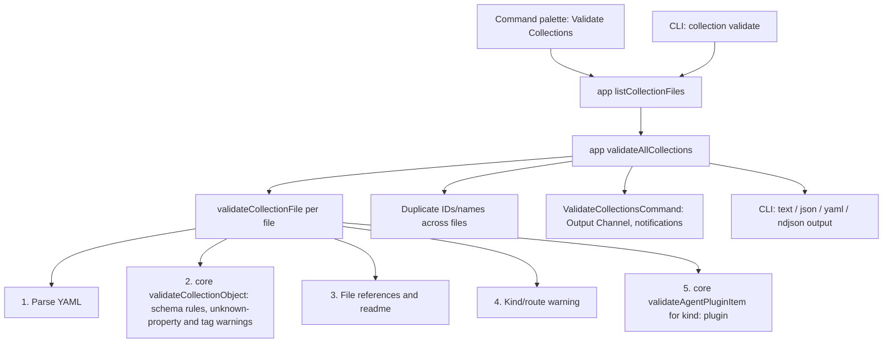
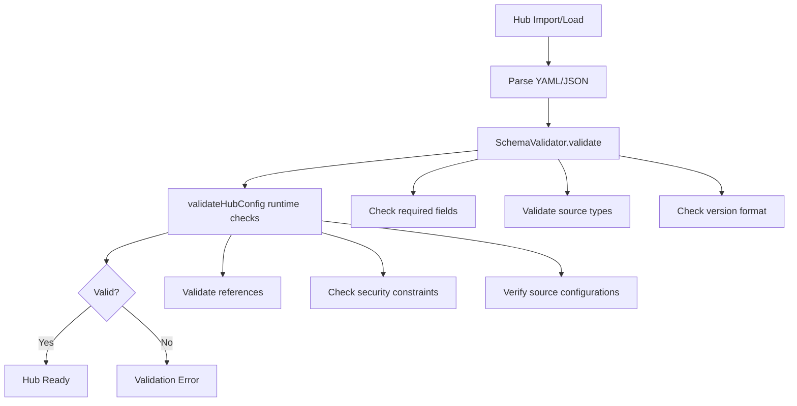

# Validation Architecture

JSON Schema validation for collections, APM packages, and hub configurations.

## Components

| Component | Responsibility |
|-----------|---------------|
| **SchemaValidator** | Extension JSON schema validation using AJV, for hub, APM and lockfile data. It no longer validates collections: `validateCollection` is deprecated and kept only as the regression oracle of the `ValidateCollectionsCommand` tests |
| **ValidateCollectionsCommand** | Delivery adapter for `promptRegistry.validateCollections` / `promptRegistry.listCollections` (`apps/vscode-extension/src/commands/validate-collections-command.ts`). Delegates to app `listCollectionFiles` + `validateAllCollections`, the same calls as CLI `collection validate`, and only renders the result in the **Collection Validator** output channel and a summary notification (it does not publish to the Problems panel); it holds no validation rule |
| **ValidateApmCommand** | Command handler for APM package validation |
| **validateCollectionObject** | Pure, hand-written enforcement of `collection.schema.json` (`packages/core/src/domain/collection/validate.ts`, nested sections and rule constants in `collection-schema-rules.ts`). Returns `{ ok, errors, warnings }`; unknown properties and the tag count/length checks are its only warnings. Wired by app `validateCollectionFile`, which adds YAML parsing, file references, readme, kind/route and plugin checks; app `validateAllCollections` adds duplicate id/name detection over `listCollectionFiles` (sorted) |
| **HubManager** | Hub configuration validation and runtime checks |
| **validateAgentPluginItem** | Pure Agent Plugins 1.0.0 `plugin.json` checks plus the plugin-root rule (`packages/core/src/domain/plugin/agent-plugin-spec.ts`). Wired by app `validateCollectionFile` for `kind: plugin` items: fatal issues become errors, non-fatal issues become warnings. Also wired by app `planBundleRelease` (`bundle build`) on the release tree it packages, read through `ReleaseSourceTree`, with the same messages (`app/src/collection/plugin-item-issues.ts`): fatal issues reject with `PLUGIN.INVALID_MANIFEST` before any archive is written, non-fatal issues become build warnings |
| **findKindRouteMismatch** | Pure kind/route comparison (`packages/core/src/domain/install/kind-route.ts`): the kind of the longest built-in layout route an item path matches, against the declared kind. Wired by app `validateCollectionFile` (`app/src/collection/kind-route-warning.ts`) over every built-in layout's routes, as a warning only; `doctor diagnostics --primitives` carries these warnings on the bundle's `I0` check |

## SchemaValidator API

```typescript
interface ValidationResult {
    valid: boolean;
    errors: string[];
    warnings: string[];
}

interface ValidationOptions {
    checkFileReferences?: boolean;
    workspaceRoot?: string;
}

class SchemaValidator {
    constructor(extensionPath?: string);
    async validate(data: any, schemaPath: string, options?: ValidationOptions): Promise<ValidationResult>;
    /** @deprecated use app validateCollectionFile / validateAllCollections */
    async validateCollection(data: any, options?: ValidationOptions): Promise<ValidationResult>;
    async validateApm(data: any, options?: ValidationOptions): Promise<ValidationResult>;
    clearCache(): void;
}

// Hub validation is handled by HubManager
class HubManager {
    async validateHub(config: HubConfig): Promise<ValidationResult>;
}
```

## Validation Flow

Both deliveries run the same app calls, so they report the same errors and warnings.



## Error Formatting

Collection messages are prefixed with the repository-relative collection file
(`L` below, for example `collections/my.collection.yml`); item messages add `items[<i>]`.

| Error Type | Example |
|------------|---------|
| YAML syntax | `L: YAML parse error: <parser message>` |
| Required field | `L: Missing required field: description` |
| ID pattern | `L: Collection ID must contain only lowercase letters, numbers, and hyphens only` |
| Item kind | `L: items[0]: Invalid item kind 'foo'. Must be one of: prompt, instruction, ...` |
| Type mismatch | `L: author must be a string` |
| Length | `L: description must be at most 500 characters (got 576)` |
| Unknown property (warning) | `L: unknown root property 'foo' is not in the collection schema; remove it or rename it to one of: id, name, ...`, `L: items[0]: unknown property 'name' is not in the collection schema; remove it or rename it to one of: path, kind, title, description, tags` |
| File reference | `L: items[0] referenced file not found: prompts/missing.prompt.md` |
| Plugin manifest | `L: items[0] plugin plugins/p/plugin.json: "author" must be an object ...` |
| Duplicate ID | `L: Duplicate collection ID 'my-id' (also in collections/other.collection.yml)` |
| Duplicate name | `L: Duplicate collection name 'My Name' (also in collections/other.collection.yml)` |

## Performance

- **Schema Caching**: Compiled schemas cached in Map
- **Lazy Loading**: Schemas loaded on first use
- **File Reference Checking**: Always enabled for complete validation

## Validation Schemas

The extension provides JSON Schema validation for all major configuration file types. Each schema enforces structure, data types, and business rules specific to its component.

### Collection Schema

**Location:** `packages/core/src/public/schemas/collection.schema.json` (exported as `COLLECTION_SCHEMA`)  
**Validates:** collection files (`.collection.yml`), through core `validateCollectionObject`

**Required fields:**
- `id` — Unique identifier (lowercase letters, numbers, hyphens only; 1-100 characters)
- `name` — Human-readable collection name (1-100 characters)
- `description` — Detailed purpose description (1-500 characters)
- `items` — Array of collection resources (no upper limit)

**Optional fields:**
- `version` — Semantic version string
- `author` — Collection author information
- `tags` — Array of categorization tags
- `mcp` — Model Context Protocol server configurations
- `display` — UI display preferences (color, icon, ordering)

**Item kinds supported:** every kind in the schema's item `kind` enum, which equals
core `PRIMITIVE_KINDS` (`prompt`, `instruction`, `chat-mode`, `agent`, `skill`,
`plugin`, `hook`, `mcp-server`, and the other target-specific kinds)

**Validation features:**
- File reference and readme checking (app `validateCollectionFile`, always on)
- MCP server and input configuration validation
- Agent Plugin manifest checks for `kind: plugin` items
- Warnings: unknown properties, tag count/length, missing readme, kind/route mismatch, non-fatal plugin issues.
  There are no generic best-practice warnings (missing version or author, long
  description, empty or large collection)

See [Author Guide: Collection Schema](../../author-guide/collection-schema.md) for complete reference.

**Enforcement in core:** core has no JSON Schema engine, so `validateCollectionObject`
mirrors every rule of `packages/core/src/public/schemas/collection.schema.json` by hand:
required fields, lengths, types, enums, patterns and the MCP server `type` /
`command` / `url` conditions are errors. Unknown keys of the closed objects (root,
`items[]`, `mcp`, each server, `mcp.inputs[]`, `display`) are warnings that name the
key, its location and the allowed keys; the keys of `mcp.items` are server names,
checked against the server-name pattern (an error). Messages follow
`<collection>: <message>` and `<collection>: items[<i>]: <message>`. There are two
deliberate differences from the schema: item kinds are matched case-insensitively, and
unknown properties are warnings, because older collections still carry legacy fields
that release planning reads (`release-manifest-plan.ts` takes root `mcpServers` before
`mcp.items` and, on the legacy path, root `license`). The published schema keeps
`additionalProperties: false`. The drift guard
`packages/core/test/domain/collection/collection-schema-drift.test.ts` compares the
constants in `collection-schema-rules.ts` with the exported `COLLECTION_SCHEMA`
(property lists, required lists, enums, limits, patterns, and the set of
`additionalProperties: false` objects), checks that each closed object is classified
(warning, or error for the pattern-keyed `mcp.items`), and fails when the schema changes
without them. `bundle build` (`planBundleRelease`) does not run these checks; it runs the
plugin checks only. The Visual Collection Editor validates with infra
`validateCollectionYaml` (AJV over the same schema), which still reports unknown
properties as errors.

### Agent Plugins Manifest Schema

**Location:** `packages/core/src/public/schemas/agent-plugins/1.0.0/plugin.schema.json` (exported as `AGENT_PLUGIN_MANIFEST_SCHEMA`)  
**Validates:** the root `plugin.json` of `kind: plugin` collection items

The schema is vendored unmodified from
[agentplugins/agent-plugins-spec](https://github.com/agentplugins/agent-plugins-spec/blob/d92e6f443b8edcea42c039727a82afdc565779e2/schemas/1.0.0/plugin.schema.json)
(Apache-2.0). Core has no JSON Schema engine, and the spec splits violations into
fatal and non-fatal, so the rules are hand-written in `validateAgentPluginManifest` /
`validateAgentPluginItem` and a parity test (`packages/core/test/domain/plugin/agent-plugin-spec.test.ts`)
asserts the constants match the vendored file.

**Validation features:**
- Fatal: unreadable / non-JSON / non-object manifest, missing or unsupported `$schema`, invalid `name`, wrongly typed standard fields, non-object `author`
- Non-fatal: unknown top-level fields, non-object `extensions` or extension entries
- APH packaging rule (fatal): the item path must be `<plugin-root>/plugin.json` below the repository root, and `name` must equal the plugin root's directory name, because bundling archives `dirname(item.path)` under that name
- Input is the item path and the manifest text; callers do the file IO, so the same checks can run on an authoring tree or an extracted archive

### APM Schema

**Location:** `schemas/apm.schema.json`  
**Validates:** APM (Awesome Prompt Manager) package manifests

**Required fields:**
- `name` — Package name (lowercase letters, numbers, dots, underscores, hyphens)
- `version` — Semantic version with optional pre-release suffix
- `description` — Package description (max 500 characters)
- `author` — Package author

**Optional fields:**
- `license` — License identifier
- `tags` — Array of tags (max 20 items, 30 characters each)
- `dependencies` — Package dependencies (`apm`, `mcp` arrays)
- `scripts` — Build/lifecycle scripts object

**Validation features:**
- Semantic version format enforcement
- Package name pattern validation
- Dependency structure validation

### Hub Configuration Schema

**Location:** `schemas/hub-config.schema.json`  
**Validates:** Hub configuration files that define bundle sources and profiles

**Required fields:**
- `version` — Semantic version of hub config format
- `metadata` — Hub metadata object
  - `name` — Hub name (1-100 characters)
  - `description` — Hub description (1-500 characters)
  - `maintainer` — Maintainer identifier (1-100 characters)
  - `updatedAt` — ISO 8601 timestamp
- `sources` — Array of bundle sources (minimum 1)

**Optional fields:**
- `profiles` — Predefined bundle collections
- `configuration` — Hub-level settings (autoSync, syncInterval, strictMode)
- `metadata.checksum` — Integrity checksum (sha256/sha512 format)

**Source types supported:**
- `github` — Git repository sources
- `local` — Local filesystem sources
- `awesome-copilot`, `local-awesome-copilot` — Awesome Copilot collections
- `apm`, `local-apm` — APM package sources

**Profile structure:**
- Bundle references with version constraints
- Source mapping and dependency resolution
- Activation state management

**Validation features:**
- Two-phase validation (schema + runtime)
- Source type compatibility checking
- Profile bundle reference validation
- Security constraint enforcement

### Default Hubs Schema

**Location:** `schemas/default-hubs-config.schema.json`  
**Validates:** Default hub configurations for extension first-run setup

**Required fields:**
- `defaultHubs` — Array of hub options
  - `name` — Display name for hub selection
  - `description` — Description shown in selector UI
  - `icon` — VS Code codicon name (without `$()` wrapper)
  - `reference` — Hub reference configuration
    - `type` — Source type (`github`, `local`, `url`)
    - `location` — Hub location (repo path, local path, or URL)

**Optional fields:**
- `reference.ref` — Git reference (branch, tag, commit) for GitHub sources
- `reference.autoSync` — Automatic synchronization flag
- `recommended` — Recommended default hub flag
- `enabled` — Visibility in first-run selector

**Validation features:**
- Hub reference structure validation
- Icon name format checking
- Source type compatibility validation

## Schema Usage Patterns

### Direct Schema Validation

```typescript
// Collection validation (app; used by the extension command and the CLI)
import { listCollectionFiles, validateAllCollections } from '@ai-primitives-hub/app';
const result = validateAllCollections(workspaceRoot, listCollectionFiles(workspaceRoot));

// APM validation  
const result = await validator.validateApm(apmManifest);

// Hub validation (two-phase)
const result = await hubManager.validateHub(hubConfig);
```

### Command-Based Validation

```typescript
// Validate all collections in workspace
await vscode.commands.executeCommand('promptRegistry.validateCollections');

// Validate APM packages
await vscode.commands.executeCommand('promptRegistry.validateApm');
```

### Runtime Integration

Hub validation occurs automatically during:
- Hub import/installation
- Configuration updates
- Profile activation/deactivation
- Source synchronization

## Hub Validation Flow

Hub validation occurs in two phases:

1. **Schema Validation** — JSON Schema validation using AJV
2. **Runtime Validation** — Additional business logic checks



## Validation Commands

| Command | Purpose | Schema Used |
|---------|---------|-------------|
| `promptRegistry.validateCollections` | Validate collection files through app `validateAllCollections` (same checks as CLI `collection validate`, including Agent Plugin manifests) | `collection.schema.json`, enforced by core `validateCollectionObject`; Agent Plugins 1.0.0 `plugin.schema.json` rules for `kind: plugin` items |
| `promptRegistry.listCollections` | List collections (name, id, description, item count, tags) | — |
| `promptRegistry.validateApm` | Validate APM packages | `apm.schema.json` |
| Hub validation | Automatic during import/load | `hub-config.schema.json` |

## See Also

- [Author Guide: Collection Schema](../../author-guide/collection-schema.md)
- [Contributor Guide: Validation](../validation.md) — Local validation commands
- [Reference: Hub Schema](../../reference/hub-schema.md) — Hub config format details
