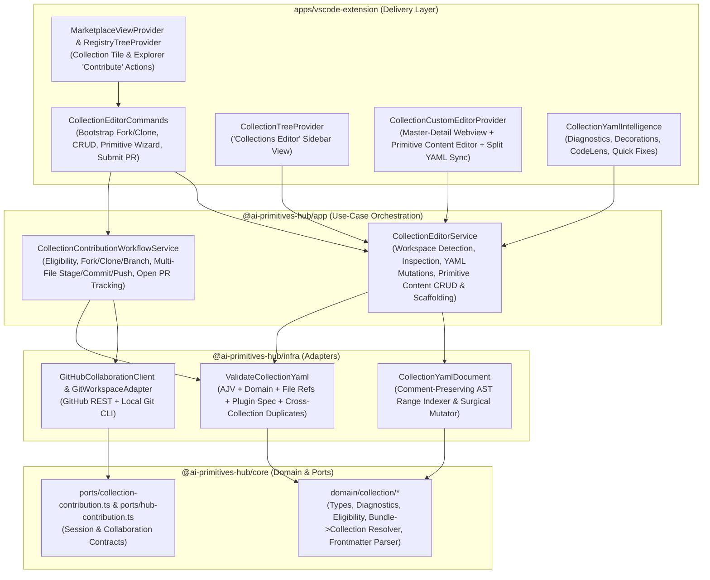

# Feasibility Study, Requirements & Design Specification: Visual Collection Editor, Workspace Collection Explorer & Contributor Workflow

**Tracking Issue:** `#604`  
**Status:** Approved  

---

## 1. Executive Summary & Objectives

Collaborating on **AI Primitives Hub collections** (`collections/*.collection.yml` and their referenced primitive files: prompts, instructions, agents, skills, plugins, hooks, MCP servers, and READMEs) historically required a code-heavy, manual workflow: locating the source repository for a Marketplace collection card, forking and cloning it manually, navigating folder structures (`collections/`, `prompts/`, `instructions/`, `agents/`, `skills/`, `plugins/`), hand-editing `.collection.yml` manifests and `---` YAML frontmatter delimiters, staging multiple files, and opening a Pull Request outside the IDE.

This specification defines an integrated **Visual Collection Editor, Dedicated `Collections Editor` Sidebar Tree View, Friendly Primitive Content Editor & End-to-End GitHub Contributor Workflow** for the VS Code extension (`apps/vscode-extension`) built on top of the shared Clean Architecture layers (`@ai-primitives-hub/core`, `@ai-primitives-hub/infra`, `@ai-primitives-hub/app`).

It delivers:
1. **One-Click Collaboration Bootstrap from Marketplace Tiles & Registry Explorer**: Start from a collection tile in the Marketplace, the Bundle Details view, or any collection/bundle/source item in the Registry Explorer (`promptregistry.contributeToCollection`), resolve the backing GitHub repository and `<collectionId>`, fork, clone, check out a feature branch, and open `collections/<collectionId>.collection.yml` in the Visual Collection Editor (while enforcing read-only guards on Artifactory sources per ADR-0008).
2. **Automatic Collection Detection & Dedicated `Collections Editor` Tree View (`promptRegistryCollectionsTree`)**: Automatically detect all `*.collection.{yml,yaml}` files in the workspace, validate them (including cross-collection duplicate `id`/`name` checks), and display every collection's `Metadata & Display`, `Primitive Items` (with file existence badges), `MCP Configuration`, and active Pull Request status in a dedicated sidebar view.
3. **Visual Collection Custom Editor (`CustomTextEditorProvider`) & Integrated Primitive Content Editor**: A Master-Detail visual editor for `**/*.collection.{yml,yaml}` with a collection switcher, comment-preserving YAML mutations (`WorkspaceEdit`), 1-click primitive scaffolding (`prompt`, `instruction`, `agent`, `skill`, `plugin`, `hook`, `readme`), an integrated **Visual Primitive Content Editor** (structured YAML frontmatter fields + Markdown body / `plugin.json`), MCP servers/inputs editor, and automatic scroll synchronization with any open split YAML editor.
4. **Live Collection YAML Intelligence**: On-the-fly `DiagnosticCollection` squiggles, inline ghost-text decorations (`TextEditorDecorationType`), `CodeLens` action bars, and `CodeAction` quick fixes (`Ctrl+.`).
5. **Multi-File Pull Request Submission & Open PR Tracking**: Validate collections, stage all modified/created `.collection.yml` manifests and primitive files, generate a structured commit message and PR description, push to the fork remote, create a Pull Request against `upstream`, and track open PR & CI check status.

---

## 2. Architecture & Layer Responsibilities

---

## 3. Staged Delivery Breakdown

| Stage | Issue | Layer(s) | Scope |
|---|---|---|---|
| **1/4** | `#605` | `packages/core` | `isContributableCollectionSource`, `resolveCollectionIdFromBundle`, `inferPrimitiveKindFromPath`, `defaultPathForPrimitiveKind`, `bumpCollectionVersion`, `parsePrimitiveFrontmatter`, `serializePrimitiveFrontmatter`, and range-mapped diagnostic contracts (`domain/collection/diagnostics.ts`, `domain/collection/contribution.ts`, `ports/collection-contribution.ts`) |
| **2/4** | `#606` | `packages/infra` | Comment-preserving `collection-yaml-document.ts` (`indexCollectionYamlRanges`, `locateCollectionYamlCursor`, `applyCollectionYamlMutation`, `summarizeCollectionYamlChanges`) and `validate-collection-yaml.ts` (`validateCollectionYaml`) |
| **3/4** | `#607` | `packages/app` | `CollectionEditorService` (workspace detection, CRUD, primitive scaffolding, visual primitive frontmatter/body read/write) and `CollectionContributionWorkflowService` (`Fork → Clone → Branch → Multi-File Commit & Open PR`) |
| **4/4** | `#608` | `apps/vscode-extension`, `docs/` | `CollectionCustomEditorProvider` + external webview (`src/ui/webview/collection-editor/`), `CollectionTreeProvider` (`Collections Editor`), `CollectionYamlIntelligence`, `CollectionEditorCommands`, Marketplace tile & Explorer bootstrap actions, tests, and docs |

---

## 4. See Also

- [Visual Hub Configuration Editor Specification](./spec-hub-config-editor.md)
- [Creating Collections](../author-guide/creating-source-bundle.md)
- [Collection Schema Reference](../author-guide/collection-schema.md)
- [Commands Reference](../reference/commands.md)
