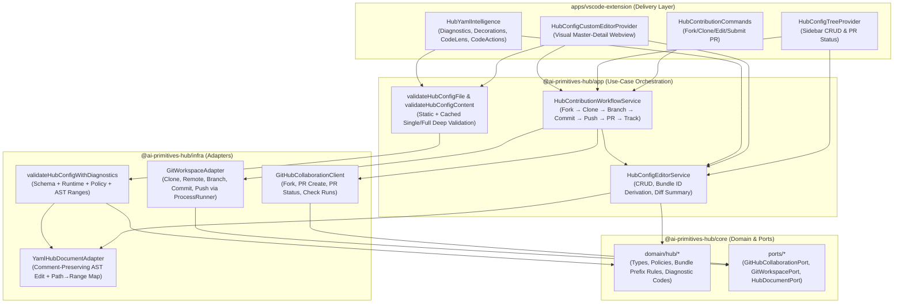
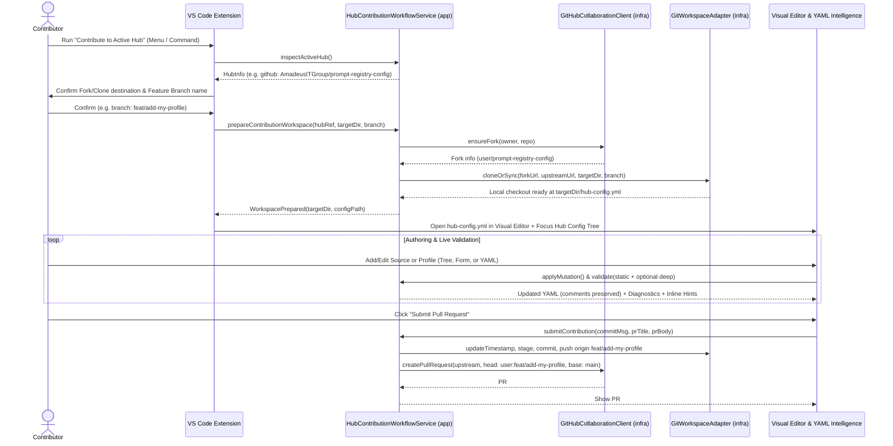

# Feasibility Study, Requirements & Design Specification: Visual Hub Configuration Editor & Contributor Workflow

**Tracking Issue:** `#578`  
**Status:** Approved  

---

## 1. Executive Summary & Objectives

Prospective contributors to an **AI Primitives Hub** (such as `prompt-registry-config`) currently face a manual, error-prone workflow: locating the upstream repository for their active hub, forking and cloning it manually, hand-editing `hub-config.yml`, understanding source-specific bundle ID prefix rules (`skills-<org>-<repo>-<skillId>` vs `<org>-<repo>-<bundleId>` vs `<bundleId>`), running CLI/CI checks to discover typos, and manually opening a Pull Request.

This specification defines an integrated **Hub Contributor Workflow & Visual Hub Configuration Editor** for the VS Code extension (`apps/vscode-extension`) built on top of the shared Clean Architecture layers (`@ai-primitives-hub/core`, `@ai-primitives-hub/infra`, `@ai-primitives-hub/app`).

It delivers:
1. **One-click Contributor Onboarding from Active Hub**: A VS Code command and menu workflow that starts from the currently active hub, forks the hub repository on GitHub, clones it locally (or attaches to an existing checkout), creates a feature branch, and opens the workspace with `hub-config.yml` loaded in visual mode.
2. **Hub Configuration Tree View**: A live hierarchical tree representing `hub-config.yml` (`Metadata`, `Sources`, `Profiles` grouped by `path` categories, and profile `Bundles`) supporting full CRUD operations and real-time validation badges.
3. **Visual Custom Editor (`CustomTextEditorProvider`)**: A form- and tree-driven visual editor synchronized bidirectionally with `hub-config.yml` via lossless YAML AST edits (preserving comments such as `# Roles`, `# Domains`, and `$schema` headers), complete with live source catalog browsing and bundle pickers.
4. **Smart YAML Text Editor Enhancements**: On-the-fly `DiagnosticCollection` squiggles, inline ghost-text `TextEditorDecorationType` hints, `CodeLens` action bars, and `CodeAction` quick fixes (`Ctrl+.`) powered by the exact same validation pipeline as the CLI (`hub validate` / `hub validate --check-sources`).
5. **Integrated Pull Request Creation & Tracking**: Commit, push, PR creation against the upstream hub repository, and live PR/CI check status tracking directly inside VS Code.

---

## 2. Feasibility Study

### 2.1 Existing Capabilities We Can Reuse Directly

| Layer | Existing Component | Capabilities Available Today |
|---|---|---|
| `packages/core` | `domain/hub/types.ts`, `domain/hub/validate.ts`, `HUB_CONFIG_SCHEMA` | Canonical `HubConfig`, `HubSource`, `HubProfile`, `HubProfileBundle`, `HubReference` types; `hasPathTraversal()`, `githubBundlePrefix()`, `validateHubSourcePolicies()`. |
| `packages/infra` | `hub/validate-hub-config.ts`, `hub/hub-resolver.ts`, `auth/*` | `parseHubConfigYaml()`, `validateHubConfig()`, `validateHubConfigDocument()` (combines runtime, AJV schema, and source policy checks); `CompositeTokenProvider`, `GhCliTokenProvider`. |
| `packages/app` | `registry/validate-hub-config-file.ts`, `registry/hub-manager.ts`, `registry/create-source-adapter.ts` | `validateHubConfigFile(fs, filePath, { deep, sourceAdapterDeps, onProgress })` performing static validation + deep source reachability, catalog bundle discovery (`HubCatalogBundle[]`), and profile bundle/version resolution (`DeepHubConfigValidationResult`). |
| `apps/vscode-extension` | `services/hub-manager.ts`, `commands/hub-commands.ts`, `adapters/vscode-session-token-provider.ts` | Active hub resolution (`hubManager.getActiveHub()`), `HubReference` inspection (`type`, `location`, `ref`), VS Code GitHub authentication (`VsCodeSessionTokenProvider` + `ensureGitHubAccountSelection`), tree & webview infrastructure. |

### 2.2 Gap Analysis & Technical Feasibility

| Gap | Technical Analysis & Solution | Risk |
|---|---|---|
| **1. Lossless YAML Editing (Preserving Comments)** | Example hub configs (`prompt-registry-config/hub-config.yml`) rely on `# yaml-language-server: $schema=...` and section comments (`# Roles`, `# Domains`, `# Languages`). `js-yaml.dump()` strips comments. **Solution:** Introduce a YAML AST document manipulator in `packages/infra` (using the `yaml` package CST/AST or AST-guided range splicing) that mutates targeted nodes (`metadata`, `sources`, `profiles`) and resolves exact `(line, col)` ranges for diagnostics without destroying comments or unrelated formatting. | Low |
| **2. Line-Accurate Diagnostics from Shared Validator** | `validateHubConfigDocument()` currently returns flat `string[]` errors. **Solution:** Extend `packages/core` and `packages/infra` with `HubValidationDiagnostic` containing `code`, `severity`, `message`, `jsonPath` (e.g., `['profiles', 1, 'bundles', 0, 'id']`), `range` (mapped via the YAML AST node table), and optional `quickFix` metadata. Keep `validateHubConfigDocument()` backward-compatible for CLI callers. | Low |
| **3. Bundle ID Derivation per Source Type** | Different source types use different bundle ID prefixes (`skills` → `skills-<org>-<repo>-<skillId>`, `github` → `<org>-<repo>-<bundleId>`, `awesome-copilot` → `<bundleId>`). **Solution:** Centralize bundle ID derivation and validation in `packages/core/src/domain/hub/validate.ts` AND allow the Visual Editor to query discovered bundles from `validateHubConfigFile(..., { deep: true })` (or single-source catalog fetch) so contributors pick valid bundle IDs from a dropdown rather than typing them by hand. | Low |
| **4. GitHub Fork & PR Operations** | `GitHubApi` port in `packages/core/src/ports/github-api.ts` is currently read-only (`getJson`, `getText`, `download`, `getJsonWithEtag`). **Solution:** Add a `GitHubCollaborationPort` (or extend `GitHubApi` with `postJson`) in `packages/core` and implement it in `packages/infra` using the existing authenticated `HttpClient` + `TokenProvider` chain (requesting `repo` / `public_repo` scope via `VsCodeSessionTokenProvider` or `gh` CLI token), plus local git operations via the existing `ProcessRunner` port (`NodeProcessRunner`). | Low-Medium |
| **5. Multi-Window / Workspace Transition on Clone** | Opening a newly cloned repository with `vscode.commands.executeCommand('vscode.openFolder', uri)` reloads the extension host in the target folder. **Solution:** Persist a lightweight contribution session state in `AppStorage` / workspace state (`hub-contribution-session.json`) keyed by local repo path so that when the extension activates in the newly opened fork workspace, it automatically detects the active contribution session, opens `hub-config.yml` in the Visual Editor, and focuses the Hub Config Tree View. | Low |

**Feasibility Verdict:** **Highly Feasible.** Every validation rule and source adapter already exists in `packages/core`, `packages/infra`, and `packages/app`. The work cleanly extends existing ports and services without violating Clean Architecture boundaries.

---

## 3. Requirements Specification

### 3.1 Functional Requirements

#### FR-1: Initiate Contribution Flow from Active Hub (GitHub-Connected Hubs Only)
- **FR-1.1:** Provide command `promptregistry.contributeToHub` ("AI Primitives Hub: Contribute to Hub (Fork, Clone & Open Visual Editor)") accessible from the Command Palette, Registry Explorer title bar, and Hub item context menu **only when the hub is connected to GitHub**.
- **FR-1.2:** Resolve the target hub automatically from `HubManager.getActiveHub()` (or from the selected hub tree node).
- **FR-1.3 (Read-Only Artifactory Hub Constraint):**
  - Hubs with `reference.type === 'artifactory'` are **read-only replicas** populated exclusively by the promotion/replication pipeline (ADR-0008) and **must not** expose the visual editor or contribution actions.
  - Only hubs connected with GitHub (`reference.type === 'github'`, a GitHub `url`, or a local Git checkout with a GitHub remote) are qualified for contribution and visual editing.
  - When an Artifactory (or non-GitHub) hub is active, the extension sets context key `promptRegistry.activeHubContributable = false` (hiding the Contribute / Edit Hub toolbar and context menu actions) and rejects direct invocation with a clear informational message explaining that Artifactory hubs are read-only and populated by promotion only.

#### FR-2: Fork, Clone, Branch & Sync Pipeline
- **FR-2.1:** Verify GitHub authentication and resolve the current user (`GET /user`).
- **FR-2.2:** Check whether `<currentUser>/<repo>` fork already exists; if not, create it via `POST /repos/<upstreamOwner>/<repo>/forks` and poll until ready.
- **FR-2.3:** Prompt for (or remember) the local parent directory for cloning (or detect if the repo is already open/cloned in the current workspace).
- **FR-2.4:** Ensure `origin` points to the user's fork (or upstream if user has direct push access and chooses direct branch) and `upstream` points to the canonical hub repository.
- **FR-2.5:** Fetch `upstream/<defaultBranch>` and prompt for a descriptive feature branch name (e.g., `feat/add-source-or-profile`), creating and checking it out cleanly.
- **FR-2.6:** Open the cloned repository in VS Code and automatically open `hub-config.yml` in the Visual Hub Config Editor.

#### FR-3: Hub Configuration Tree View (Sidebar CRUD & Navigation)
- **FR-3.1:** Provide a dedicated tree representation when a workspace contains `hub-config.yml` (or when a `hub-config.yml` editor is active).
- **FR-3.2:** Display structured nodes:
  - **Contribution Status Node**: Upstream repo, Fork/Branch, Validation summary (`Valid` / `N Errors`), and PR status (`Not Created` / `PR #42 Open · Checks Passing`).
  - **Metadata Node**: Hub `name`, `version`, `maintainer`, `updatedAt`.
  - **Sources Node (`Sources (N)`)**: Lists each `HubSource` with icon, `id`, `type`, `priority`, enabled state, and validation status badge.
  - **Profiles Node (`Profiles (M)`)**: Organizes `HubProfile` items hierarchically by their `path` array (e.g., `Roles`, `Domains`, `Languages`, `Platforms`, `Tools`), with child nodes for each `HubProfileBundle` (`id @ version [source]`).
- **FR-3.3:** Support direct CRUD operations from tree item inline/context actions:
  - Add / Edit / Duplicate / Toggle Enabled / Delete Source (with warning if profiles reference the source).
  - Add / Edit / Duplicate / Move Category (`path`) / Delete Profile.
  - Add / Edit / Toggle Required / Remove Bundle in a Profile.
- **FR-3.4:** Clicking a tree node reveals and highlights the item in both the Visual Editor and the YAML Text Editor.

#### FR-4: Visual Hub Configuration Editor (`CustomTextEditorProvider`)
- **FR-4.1:** Register custom editor `promptregistry.hubConfigEditor` for `**/hub-config.{yml,yaml}`.
- **FR-4.2:** Provide a two-pane master-detail webview interface:
  - **Header Toolbar**: Hub title, validation status pill, `Validate Static`, `Deep Validate (Check Sources & Bundles)`, `Update Timestamp`, `Switch to YAML / Split View`, and `Commit & Create PR` / `View PR Status`.
  - **Master Outline**: Filterable tree of Metadata, Sources, and Profiles (grouped by `path`).
  - **Detail Inspector**:
    - **Metadata Editor**: Edit `version`, `name`, `description`, `maintainer`, and `updatedAt` (with auto-touch on edits).
    - **Source Editor**: Edit `id`, `name`, `type`, `url`/`repository`, `priority` (0–100), `enabled`, conditional `config` (`branch`, `collectionsPath`, `indexFile`, `authMode`, `credentialRef`), and `metadata` (`description`, `homepage`, `contact`). Includes a **"Verify & Load Bundles"** action that runs adapter validation and previews discovered bundles.
    - **Profile Editor**: Edit `id`, `name`, `icon`, `description`, `path` segments, and manage the **Bundles List** via an interactive **Bundle Picker** populated from discovered source catalogs (automatically formatting bundle IDs according to source type conventions: `skills-<org>-<repo>-<skillId>`, `<org>-<repo>-<bundleId>`, or `<bundleId>`).
- **FR-4.3:** All visual CRUD operations apply edits through `vscode.WorkspaceEdit` on the underlying `TextDocument`, preserving YAML comments and supporting native Undo/Redo.

#### FR-5: Live YAML Editor Validation, Decorations, CodeLens & CodeActions
- **FR-5.1:** **On-the-fly Validation (`DiagnosticCollection`)**: Validate `hub-config.yml` on open and on keystroke (debounced 250ms) using the shared `validateHubConfigDocument` + policy checks, mapping errors/warnings to exact YAML AST line/column ranges.
- **FR-5.2:** **Deep Validation Integration**: Merge deep validation results (`validateHubConfigFile(..., { deep: true })`) into the same `DiagnosticCollection` and decoration state (highlighting unreachable sources, missing bundles, or non-existent versions).
- **FR-5.3:** **Inline Editor Decorations (`TextEditorDecorationType`)**: Render non-intrusive inline hints showing source status/bundle counts, profile bundle counts, resolved bundle versions, and stale `updatedAt` warnings.
- **FR-5.4:** **CodeLens Actions (`CodeLensProvider`)**: Provide clickable inline commands above `metadata`, `sources`, individual source blocks, `profiles`, and individual profile blocks (`+ Add Source`, `+ Add Profile`, `+ Add Bundle`, `Validate Source`, `Edit Visually`, `Submit PR`).
- **FR-5.5:** **Quick Fixes (`CodeActionProvider`)**: Provide lightbulb fixes for common validation errors:
  - Prepend expected GitHub/Skills bundle prefix (`<owner>-<repo>-` or `skills-<org>-<repo>-`).
  - Update `metadata.updatedAt` to current ISO-8601 timestamp.
  - Add required `config` block to `awesome-copilot` source or remove forbidden `config` block from `github` source.
  - Create missing source stub when a profile bundle references an unknown `source` ID.

#### FR-6: Pull Request Submission & Tracking
- **FR-6.1:** Provide a guided **Submit Contribution** flow (`promptregistry.submitHubPullRequest`):
  1. Run pre-flight validation (static + optional deep check for modified sources/profiles).
  2. Auto-update `metadata.updatedAt` if not already updated.
  3. Generate a structured commit message and PR description summarizing added/modified/removed sources and profiles.
  4. Stage `hub-config.yml`, commit, and push the branch to the fork remote.
  5. Create the Pull Request against the upstream hub repository via GitHub API.
- **FR-6.2:** Track the created (or existing branch-matched) PR in the Hub Config Tree View and Visual Editor header:
  - Display PR number, title, state (`Open`, `Draft`, `Merged`, `Closed`), review decision, and CI check-run summary (`Pending`, `Passing`, `Failing`).
  - Provide quick actions to **Refresh PR Status**, **Push New Changes**, and **Open PR in Browser**.

---

### 3.2 Non-Functional Requirements

- **NFR-1 (Clean Architecture Alignment):** All validation rules, bundle prefix calculators, YAML AST range mapping, and contribution workflow orchestration must reside in `@ai-primitives-hub/core`, `@ai-primitives-hub/infra`, and `@ai-primitives-hub/app`. Delivery code in `apps/vscode-extension` only wires VS Code APIs (`WebviewPanel`, `TreeDataProvider`, `DiagnosticCollection`, `CodeLensProvider`, `CodeActionProvider`).
- **NFR-2 (Comment & Format Preservation):** Editing `hub-config.yml` through the Visual Editor or Quick Fixes must preserve top-of-file `$schema` directives and section comments (such as `# Roles`, `# Domains` in `prompt-registry-config/hub-config.yml`).
- **NFR-3 (Performance & Resource Efficiency):**
  - Static validation on keystroke completes in `< 30ms` (offline, zero network calls).
  - Deep validation caches per-source catalog results in memory with ETag / TTL support and can validate a single modified source on demand rather than re-fetching all unchanged sources on every check.
- **NFR-4 (Security):** Tokens are resolved exclusively through `CompositeTokenProvider` / `VsCodeSessionTokenProvider` / `SecretStorage` and are never written to `hub-config.yml`, git remote URLs on disk, or logs.

---

## 4. Architecture & Design Specification

### 4.1 High-Level Component Architecture



---

### 4.2 End-to-End Contributor Sequence Flow



---

### 4.3 Layer-by-Layer Design Details

#### 4.3.1 `@ai-primitives-hub/core` Additions

1. **Bundle Prefix & Identity Helpers (`packages/core/src/domain/hub/validate.ts`)**:
   - Extend bundle prefix derivation to cover all source types used in hubs:
     - `github`: `<owner>-<repo>-<bundleId>` (via `githubBundlePrefix(url)`)
     - `skills`: `skills-<owner>-<repo>-<skillId>` (via new `skillsBundlePrefix(url)`)
     - `awesome-copilot`: `<bundleId>`
   - Add `deriveExpectedBundlePrefix(source: Pick<HubSource, 'type' | 'url'> & { repository?: string }): string | null`
   - Add `formatHubBundleId(source: Pick<HubSource, 'type' | 'url'>, rawBundleId: string): string`
2. **Structured Diagnostics (`packages/core/src/domain/hub/diagnostics.ts`)**:
   ```typescript
   export type HubDiagnosticCode =
     | 'HUB_YAML_SYNTAX_ERROR'
     | 'HUB_SCHEMA_VIOLATION'
     | 'HUB_MISSING_REQUIRED_FIELD'
     | 'HUB_INVALID_SEMVER'
     | 'HUB_DUPLICATE_SOURCE_ID'
     | 'HUB_DUPLICATE_PROFILE_ID'
     | 'HUB_PATH_TRAVERSAL'
     | 'HUB_SOURCE_FORBIDDEN_CONFIG'
     | 'HUB_SOURCE_REQUIRED_CONFIG'
     | 'HUB_UNKNOWN_SOURCE_REFERENCE'
     | 'HUB_INVALID_BUNDLE_PREFIX'
     | 'HUB_SOURCE_UNREACHABLE'
     | 'HUB_BUNDLE_NOT_FOUND'
     | 'HUB_BUNDLE_VERSION_NOT_FOUND'
     | 'HUB_STALE_UPDATED_AT';

   export interface SourceRange {
     startLine: number;   // 0-based
     startColumn: number; // 0-based
     endLine: number;
     endColumn: number;
   }

   export interface HubValidationQuickFix {
     title: string;
     kind:
       | 'update-timestamp'
       | 'fix-bundle-prefix'
       | 'add-source-config'
       | 'remove-source-config'
       | 'create-missing-source';
     jsonPath: (string | number)[];
     replacementValue?: unknown;
   }

   export interface HubValidationDiagnostic {
     code: HubDiagnosticCode;
     severity: 'error' | 'warning' | 'info';
     message: string;
     jsonPath: (string | number)[];
     range?: SourceRange;
     quickFix?: HubValidationQuickFix;
   }
   ```
3. **Collaboration & Git Workspace Ports (`packages/core/src/ports/hub-contribution.ts`)**:
   - `GitHubCollaborationPort`:
     - `getAuthenticatedUser(): Promise<{ login: string; htmlUrl: string }>`
     - `getRepository(owner: string, repo: string): Promise<GitHubRepoMetadata>`
     - `ensureFork(owner: string, repo: string): Promise<GitHubForkInfo>`
     - `createPullRequest(input: CreatePullRequestInput): Promise<HubPullRequestInfo>`
     - `findPullRequestsForBranch(owner: string, repo: string, headRef: string): Promise<HubPullRequestInfo[]>`
     - `getPullRequestChecks(owner: string, repo: string, pullNumber: number): Promise<HubPullRequestStatus>`
   - `GitWorkspacePort`:
     - `isGitRepository(dir: string): Promise<boolean>`
     - `cloneRepository(cloneUrl: string, targetDir: string): Promise<void>`
     - `ensureRemote(dir: string, name: string, url: string): Promise<void>`
     - `getRemotes(dir: string): Promise<Record<string, string>>`
     - `getCurrentBranch(dir: string): Promise<string>`
     - `checkoutNewBranch(dir: string, branch: string, startPoint?: string): Promise<void>`
     - `checkoutBranch(dir: string, branch: string): Promise<void>`
     - `fetchRemote(dir: string, remote: string, branch?: string): Promise<void>`
     - `getStatus(dir: string): Promise<{ modified: string[]; staged: string[]; ahead: number; behind: number }>`
     - `commitAndPush(dir: string, files: string[], message: string, remote: string, branch: string): Promise<{ commitSha: string }>`

#### 4.3.2 `@ai-primitives-hub/infra` Additions

1. **Comment-Preserving YAML Document Adapter (`packages/infra/src/hub/hub-yaml-document.ts`)**:
   - Uses `yaml` CST/AST parsing (or line-indexed AST node locator) to:
     - Map any `jsonPath` (e.g., `['sources', 2, 'id']`, `['profiles', 0, 'bundles', 1, 'source']`) to its exact `SourceRange` (`startLine`, `startColumn`, `endLine`, `endColumn`) in `hub-config.yml`.
     - Map any cursor line number in `hub-config.yml` back to the enclosing semantic entity (`{ section: 'metadata' } | { section: 'source', index: number, id?: string } | { section: 'profile', index: number, id?: string, bundleIndex?: number }`).
     - Apply surgical CRUD mutations (`upsertSource`, `removeSource`, `upsertProfile`, `removeProfile`, `upsertProfileBundle`, `removeProfileBundle`, `updateMetadata`) while preserving comments (such as `# Roles`, `# Domains`, `# yaml-language-server: $schema=...`).
2. **Diagnostic-Enriched Validator (`packages/infra/src/hub/validate-hub-config.ts`)**:
   - `validateHubConfigYaml(content: string): { config: unknown; valid: boolean; errors: string[]; warnings: string[]; diagnostics: HubValidationDiagnostic[]; nodeRanges: Map<string, SourceRange> }`
   - Produces structured `HubValidationDiagnostic` items with exact `range` and `quickFix` payloads for every schema, runtime, source-policy, and bundle-prefix rule.
3. **GitHub Collaboration & Git Adapters (`packages/infra/src/hub/github-collaboration-client.ts`, `git-workspace-adapter.ts`)**:
   - Implements `GitHubCollaborationPort` over `HttpClient` + `TokenProvider`.
   - Implements `GitWorkspacePort` over `ProcessRunner` (`git` CLI).

#### 4.3.3 `@ai-primitives-hub/app` Additions

1. **`HubConfigEditorService` (`packages/app/src/hub-editor/hub-config-editor-service.ts`)**:
   - Stateless/cache-aware orchestration for editing and validating a `hub-config.yml` document:
     - `inspectDocument(content: string)`: returns parsed `HubConfig`, AST `nodeRanges`, static `diagnostics`, and summary statistics (sources count, profiles grouped by `path`, bundle reference counts per source).
     - `validateDeep(content: string, options: { sourceId?: string; onProgress?: ... })`: runs `validateHubConfigFile` / single-source adapter discovery and caches per-source `HubCatalogBundle[]` so the UI Bundle Picker and inline YAML decorations have instant access to available bundle IDs and versions.
     - `applyMutation(content: string, mutation: HubConfigMutation): { updatedContent: string; diagnostics: HubValidationDiagnostic[] }`:
       - Supports mutations: `updateMetadata`, `touchUpdatedAt`, `addSource`, `updateSource`, `deleteSource`, `addProfile`, `updateProfile`, `deleteProfile`, `addProfileBundle`, `updateProfileBundle`, `removeProfileBundle`, `applyQuickFix`.
       - Automatically updates `metadata.updatedAt` when sources or profiles change.
       - When renaming a source ID (if explicitly requested), optionally cascades the ID update across profile bundle references.
     - `summarizeChanges(baseContent: string, currentContent: string): HubChangeSummary`: computes added/modified/removed sources, profiles, and bundles to auto-populate commit messages and PR descriptions.
2. **`HubContributionWorkflowService` (`packages/app/src/hub-editor/hub-contribution-workflow.ts`)**:
   - Orchestrates the contributor lifecycle:
     - `resolveTargetHub(hubId?: string)` from `HubManager`.
     - `bootstrapForkAndClone({ hubReference, localParentDir, branchName })` → returns `{ workspaceDir, hubConfigPath, upstreamRepo, forkRepo, branchName }`.
     - `getWorkspaceContributionState(workspaceDir)` → inspects git remotes (`origin`, `upstream`), current branch, uncommitted diff summary, and active GitHub PR status.
     - `submitPullRequest({ workspaceDir, hubConfigPath, commitMessage, prTitle, prBody, draft })` → validates, commits, pushes, creates PR, and returns `HubPullRequestInfo`.
     - `refreshPullRequestStatus(workspaceDir)` → queries PR merge state + CI check runs.

#### 4.3.4 `apps/vscode-extension` Additions

1. **Commands & Menus (`apps/vscode-extension/package.json` & `src/commands/hub-editor-commands.ts`)**:
   - New commands:
     - `promptregistry.contributeToHub` — "Contribute to Hub (Fork, Clone & Open Visual Editor)" (`$(git-pull-request-create)`)
     - `promptregistry.openHubVisualEditor` — "Open Hub Configuration in Visual Editor" (`$(open-preview)`)
     - `promptregistry.validateHubConfig` — "Validate Hub Configuration (Static & Deep)" (`$(check-all)`)
     - `promptregistry.addHubSource` — "Hub Config: Add Source" (`$(add)`)
     - `promptregistry.addHubProfile` — "Hub Config: Add Profile" (`$(add)`)
     - `promptregistry.submitHubPullRequest` — "Hub Config: Commit & Create Pull Request" (`$(git-pull-request)`)
     - `promptregistry.refreshHubPullRequestStatus` — "Hub Config: Refresh Pull Request Status" (`$(sync)`)
   - Menu placements:
     - `view/title` on `promptRegistryExplorer` and `promptRegistryHubConfigTree`
     - `view/item/context` on `viewItem == hub` in `promptRegistryExplorer`
     - `editor/title` when `resourceFilename =~ /^hub-config\.ya?ml$/` (Quick button to open Visual Editor or run Deep Validation)

2. **Hub Configuration Tree View (`src/ui/hub-config-tree-provider.ts`)**:
   - Contributed view `promptRegistryHubConfigTree` ("Hub Configuration Editor") in the `promptRegistry` activity bar container (visible when workspace contains `hub-config.yml` or when editing a hub config).
   - Interactive tree nodes:
     - `Contribution Status` (Upstream, Fork, Branch, PR State, Validation State)
     - `Metadata` (`name`, `version`, `maintainer`, `updatedAt`)
     - `Sources` → `<source.name> (id)` with inline actions (Edit, Validate & Discover, Toggle, Delete)
     - `Profiles` → Category folders (`Roles`, `Domains`, etc.) → `<profile.icon> <profile.name> (id)` → `<bundle.id> @ <bundle.version>` with inline actions (Add Profile, Edit Profile, Add Bundle, Delete).

3. **Visual Hub Configuration Custom Editor (`src/ui/hub-config-custom-editor.ts` + `src/ui/webview/hub-config-editor/`)**:
   - Implements `vscode.CustomTextEditorProvider` for `**/hub-config.{yml,yaml}`.
   - Bidirectional sync with `vscode.TextDocument`:
     - Document changes → parse & validate via `HubConfigEditorService.inspectDocument()` → post `stateUpdated` to webview.
     - Webview CRUD actions (`addSource`, `updateSource`, `deleteSource`, `addProfile`, `updateProfile`, `deleteProfile`, `addBundle`, `removeBundle`, `applyQuickFix`, `validateDeep`, `submitPr`) → apply `vscode.WorkspaceEdit` to `TextDocument`.
   - Rich interactive modals/panels for:
     - **Source Authoring** with live URL normalization, source-type policy enforcement, and 1-click "Discover Bundles" preview.
     - **Profile & Bundle Authoring** with category path chips and a searchable **Bundle Catalog Picker** that auto-populates valid bundle IDs and versions from the hub's sources.
     - **PR Submission & Tracker Drawer** showing changed sources/profiles diff summary, commit/PR form, and live PR check status.

4. **YAML Text Editor Intelligence (`src/services/hub-yaml-intelligence.ts`)**:
   - Activated automatically for any open `**/hub-config.{yml,yaml}` `TextDocument`:
     - **`DiagnosticCollection`**: Instant schema, policy, and bundle-prefix squiggles + deep validation diagnostics.
     - **`TextEditorDecorationType`**: Inline ghost-text annotations after source, profile, bundle, and `updatedAt` lines.
     - **`CodeLensProvider`**: Inline action buttons at top of file, `sources:`, each source item, `profiles:`, and each profile item.
     - **`CodeActionProvider`**: Quick fixes (`Ctrl+.`) for prefix repair, timestamp update, config block repair, and missing source creation.

---

## 5. Implementation Plan & Phasing

| Phase | Scope | Key Deliverables & Tests |
|---|---|---|
| **Phase 1: Core & Infra — YAML AST, Diagnostics & Bundle Prefix Rules** | `packages/core`, `packages/infra` | `HubValidationDiagnostic`, `deriveExpectedBundlePrefix` (supporting `github`, `skills`, `awesome-copilot`), comment-preserving `YamlHubDocumentAdapter` (AST range locator + surgical CRUD mutator), `validateHubConfigYaml`. Unit tests in `core` and `infra` against `prompt-registry-config/hub-config.yml`. |
| **Phase 2: Core, Infra & App — Editor Service & Contribution Workflow** | `packages/core`, `packages/infra`, `packages/app` | `GitHubCollaborationPort` + `GitWorkspacePort` and their `infra` adapters; `HubConfigEditorService` (CRUD, single-source/deep catalog caching, change summary); `HubContributionWorkflowService` (Fork → Clone → Branch → Commit → Push → Create PR → Track PR). Unit tests in `infra` and `app`. |
| **Phase 3: VS Code Extension — Tree View, Visual Custom Editor & YAML Intelligence** | `apps/vscode-extension` | `HubConfigTreeProvider`, `HubConfigCustomEditorProvider` + webview UI (`src/ui/webview/hub-config-editor/`), `HubYamlIntelligence` (`DiagnosticCollection`, `TextEditorDecorationType`, `CodeLensProvider`, `CodeActionProvider`), `HubEditorCommands` (`contributeToHub`, `openHubVisualEditor`, `submitHubPullRequest`, etc.). Unit & integration tests. |
| **Phase 4: Documentation & End-to-End Verification** | `docs/` | Update `docs/author-guide/adding-profile-source-to-hub.md`, `docs/reference/commands.md`, and `docs/README.md`. Run full compile, lint, and test suites across `packages/` and `apps/vscode-extension`. |

---

## 6. Acceptance Criteria

1. Users can invoke **Contribute to Hub** from the active GitHub-connected hub (or hub context menu) to fork, clone (or attach to a local checkout), create a branch, and open `hub-config.yml` in the Visual Editor.
3. Opening `hub-config.yml` populates the **Hub Configuration Tree View** and **Visual Custom Editor**, allowing full CRUD on `metadata`, `sources`, `profiles`, and profile `bundles` while preserving YAML comments (`# Roles`, `# Domains`, `$schema`).
4. Both the Visual Editor and raw YAML editor use the shared validation pipeline (`core` / `infra` / `app`), surfacing immediate static diagnostics and on-demand deep source/bundle validation.
5. Editing `hub-config.yml` in the raw YAML editor displays live `DiagnosticCollection` squiggles, inline ghost-text decorations, `CodeLens` action links, and `CodeAction` quick fixes.
6. Contributors can commit, push, create a Pull Request against the upstream hub repository, and track PR/check status from the extension.
